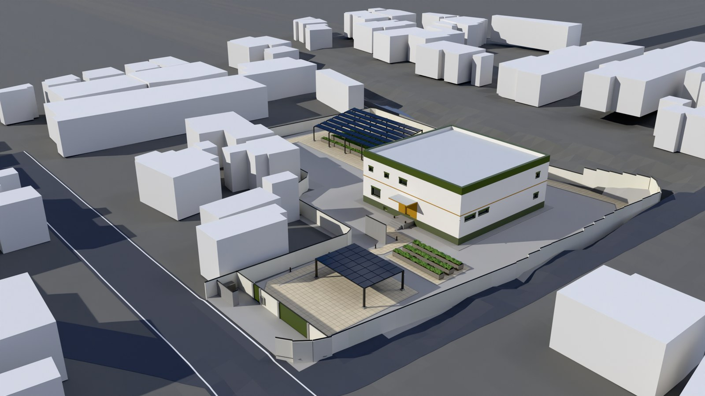
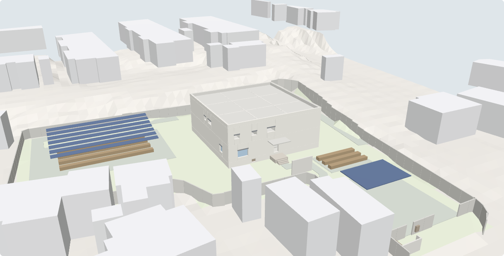
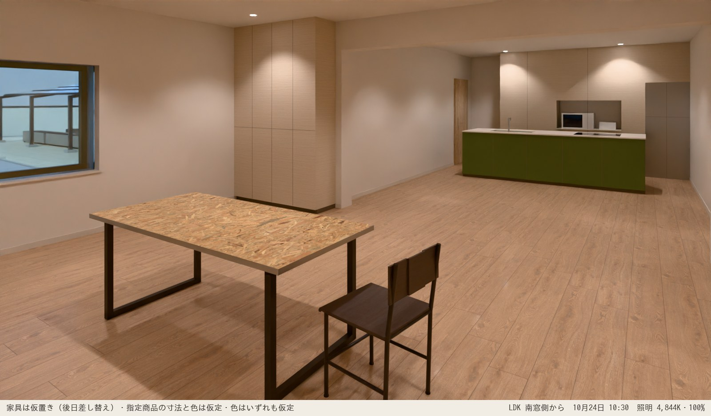

# 河沿要（仮称）— 壁式RC造 2階建て専用住宅：基本計画図・法規チェック・3Dモデル

八王子市大和田町7丁目（ひよどり山トンネル南口の西、A3（エースリー）店舗とその西側駐車場の土地）に計画する住宅の基本計画です。
設計条件は [`docs/kawazanyo_design_brief_v3.md`](docs/kawazanyo_design_brief_v3.md)（v2 から敷地・高低差・外構を更新）と、その数値版の [`spec.yaml`](spec.yaml) にまとめています。





## 敷地の推定（v3 で更新）
| 項目 | 値 |
|---|---|
| 敷地面積 | **約2,772m²（839坪）**。推定誤差 ±5%程度、要測量 |
| 方法 | 国土地理院 基盤地図情報の道路縁・水涯線（北・東・南の境界）＋施主加筆線（西・北西・南西）＋隣接建物からの推定線（南西の一部）。図: [`docs/site_estimate.png`](docs/site_estimate.png) |
| 高低差（DEM5A） | 敷地 TP+109.3〜109.6m／南側道路 109.0m／北側道路 112.5〜113.0m／東側道路 109.0→112.9m。**北・東の方が高い** |
| データ | [`data/site_gsi.json`](data/site_gsi.json)（道路縁・水路・周辺建物・等高線・2mグリッドの標高） |

## 間取り（v3.1）
回遊動線（1階2ルート・2階2ルート、階段2か所）、家事動線（キッチン→パントリー→ランドリー→ファミリークローゼット、階段2で2階ファミクロへ直結）、防音ゾーニング（ジム1階・シアター2階を南東に上下で集約し、機械室・前室・WIC を緩衝帯にする）を優先して計画。ジムは 45.7m²（従前の1.32倍）。詳細はブリーフ v3 第9章。

v3.2: 2階も全窓 FIX ＋機械排煙（開口部・排煙計画は A-10）。ジムは外部扉を廃止して FIX 高窓（防犯合わせガラス）に変更し、搬入は玄関から（二重框を上がってホールで右折し、遮音ドアからジムへ。段差解消機・SIC なし）。ジムの機器は商業ジム相当を想定。太陽光は駐車場のカーポートのみで、屋根には設置しない。

v4（B案）: 内寸18.0m角（壁芯 6.125／6.0／6.125）。冷暖房負荷・耐震性・必要発電量の概算（M-01・S-03）を追加し、全室 通年の室内環境目標（湿度55〜60%、夏25〜26℃、冬20〜21℃）で負荷を算定。太陽光は本館と分離した日よけ付き菜園（ソーラーパーゴラ 180m²、約27kWp）に設置し、3台用ソーラーカーポートを併設し、パーゴラの被覆率と影による損失を補う（合計 約37kWp）。玄関は本館から独立した自立壁1枚（L4.4m・H2.7m）で南側道路から隠し（視線判定 0/17 地点）、出2.0mの庇を設ける。東西は開放。

v4.4: 建物・外構を南側道路に平行・直交させた（真東西から12.3°回転）。日射取得・発電量を方位別に再計算した（M-02）。
v4.5: 全窓を樹脂サッシ＋Low-E トリプルガラスに統一し、紫外線対策（UVカット合わせガラス・南東西の外付け電動ブラインド）を追加した（M-03）。
v4.6: インテリアを「安全」「清掃・メンテナンスが簡易」で統一（I-01 内装設計方針・I-02 内装仕上表）。階段まわりをすき間のない手すり壁とし、外付けの日よけを羽根のない ZIP スクリーンに変更した。
v4.7: 家具は突っ張り式（RC 壁に固定しない）、床清掃は掃除ロボット、タンク式便器。スクリーン・照明・空調・ロボットを bot から操作できる制御（E-02）、調光・調色 LED、Wi-Fi 電波計画（E-01）、外構の防虫計画（E-03）を追加した。
v4.8: 南側の門を4m 後退し、門の外・両門扉の中間に道路から見えないゴミ収集ボックス（L形の目隠し壁）を設けた（A-02D）。カーポートを8m 北へ移した。
v4.9: 菜園まわりの透水設備（旧 浸透トレンチ・通路）を全て Dotcon+ にした（約324m²、合計 約496m²）。
v4.10: ゴミ収集ボックスを門の外の西の角へ移し、人用門扉を東へ。勝手口を廃止。車両盗難対策（電動門扉・昇降ボラード・前向き駐車・電波遮断キーボックス・赤外線カメラ）を追加した。
v4.11: ゴミ収集ボックスを南へ寄せ、袖壁を 1.5m→0.6m に短縮（南東の角から一部がわずかに見えるのは了承）。
v4.12: 強盗（闇バイト型）対策を強化（S-04）: 門のインターホン・貫通型宅配ボックス、忍び返し、全窓 CP、玄関 CP 防犯扉、非常ボタン・機械警備・LTE、2階 WIC を避難室に。
v4.13: Blueprint 型の暮らしに対応（M-04）: 寝室1部屋1人・CO2 800ppm 以下の需要制御換気、完全遮光・室ごとの温度設定、浄水、日なたのプランター菜園（脚付きで床を傷めない）。
v4.14: 施主の再配置図で敷地境界・塀を北と東で内側へ寄せ、北東の角を除外（約2,630m²）。Dotcon+ を再配置図の位置に（約838m²）。
v4.15: 外装色（ベース `#F5EFE3`・アソート `#4F5B2A`・アクセント `#B8892D`、いずれも仮定）、塀（`#FFF8F0`〜`#ECE7D1` の範囲で5段階）・Dotcon+ `#D8C9A8` の色、指定のない面はコンクリート（地面は透水性コンクリート・要施主確認）。外観CG 7カット（`dist/render/`）と、仕上表 I-02・立面図 A-06 への反映。ブリーフ25章。
v4.17: キッチン・パントリーの全露出（I-06）、玄関ホールの透明扉 GD-1・GD-2、主照明を直付ライン LED・埋込を弱い補助灯に再構成（E-04〜E-06、`src/lighting.py`）、階段の足元灯（踏面+300）。六角形照明は実在確認・試験のうえ不採用（`docs/cg_lighting_hex_vs_line.jpg`）。内装CG は13カット。
v4.16: 内装の仮置きと内装CG。リビングのチェアは「ペッパー スクールチェア チャコールブラウン」1脚だけ、テーブルは「マテリア ダイニングテーブル OSB 177.5cm ロの字脚」を仮置き（寸法・色は仮定、要施主確認）。ほかの家具・照明・仕上げの色は仕様者が決めた。家具配置図 I-03（1階）・I-04（2階）、家具表・内装色彩計画 I-05、内装CG 13カット（`dist/render/interior/`、代表: `docs/cg_I01_ldk_south.jpg`・`docs/cg_I02_ldk_dusk.jpg`）。ブリーフ26章。家具は仮置き（後日差し替え）。



## 生成物（`dist/`）
- `drawings.pdf`：A3 全17枚、`dxf/*.dxf`：CAD 用、`png/`：画像
  - A-00 表紙／A-01 配置図・求積図（座標求積）／A-02 外構・雨水排水計画図／A-03・04 平面図／A-05 屋根伏図／A-06 立面図／A-07 断面図（建物）／A-08 敷地断面図（地形・浸水）／A-09 建具表／A-10・11 法規チェックリスト／S-01 基礎伏図・耐力壁配置図（壁量）／S-02 RC塀・止水・透水舗装 詳細図
- `model.glb`：3Dモデル。建物、RC塀、Dotcon+ 舗装、カーポート、周辺建物、地形を含む
- `render/*.png`：外観CG 7カット（C01 門まわり／C01b 南東角／C02 南東上空／C03 玄関／C04 パーゴラ／C05 東側道路／C06 夕景）。1920×1080（C01b は 1600×900）
- `model_interior.glb`：内装CG 用の3Dモデル（家具・天井・床仕上げ・内壁仕上げ・扉・照明器具を加えたもの。ビューアは従来どおり `model.glb`）
- `render/interior/*.png`：内装CG 13カット（I01 LDK／I02 LDK夕景／I03 キッチン／I04 玄関／I05 階段／I06 ジム／I07 シアター／I08 図書室／I09 主寝室／I10 洗面・浴室／I11 ランドリー）。1600×900＋注記の帯
- `LEGAL_CHECK.md`：法規チェック 59項目。不適合0、要確認12（用途地域・防火指定・採光補正係数・2階の排煙・構造計算など）
- ビューア: [`index.html`](index.html)。3D表示、断面表示、図面一覧、法規チェック表を見られます

## 再生成
```
pip install ezdxf matplotlib shapely trimesh pyyaml mapbox_earcut
python3 src/build.py
```
外観CG（Blender の Python モジュール bpy と Cycles、CPU で約1時間）:
```
python3 -m venv .venv-bpy && .venv-bpy/bin/pip install bpy==5.0.1   # 初回のみ
python3 src/render_cg.py            # 全カット（--preview で構図確認、--only C03 で1カット）
python3 tests/test_colors.py        # 色・材質・外壁比率の試験
python3 src/render_cg.py --interior # 内装CG 13カット（約1時間。--preview で構図確認、--only I01,I02 で一部）
python3 tests/test_furniture.py     # 家具の干渉・チェアの総数・すき間・GLB の試験
```

## ソース構成
- `src/house.py`：住宅モデル（壁式RC・諸室・開口・階段・敷地・外構）
- `src/house_sheets.py`・`src/sheetlib.py`・`src/cadlib.py`：図面（JIS A 0150 の線の使い分け、モデル空間 1:1・mm、A-/S-/G- レイヤ）
- `src/views.py`：3D の部材を切断・投影して、隠れる線を消しながら平面・立面・断面を作図
- `src/house_legal.py`：法規チェック（建築基準法・施行令・平13国交告1026号・東京都建築安全条例ほか）
- `src/model3d.py`：glTF 出力（材質キーごとの色・外壁の割り付け・CG用の要素）
- `src/furniture.py`（家具の定義・配置・干渉検査）・`src/furniture_shapes.py`（家具の形）・`src/interior_shell.py`（床・天井・内壁・扉・階段まわり）・`src/furniture_sheets.py`（I-03〜I-05）・`src/render_interior.py`・`src/cg_interior.py`：家具の仮置きと内装CG
- `src/render_cg.py`・`src/cg_blender.py`：外観CG（段階1: 場面の定義とテクスチャ取得、段階2: Blender で描画）

## 注意
敷地面積・高低差は公開データからの推定です。用途地域は準工業地域と推定しており、確認が必要です。測量・地盤調査・構造計算・行政協議（水路の占用、がけ条例、雨水浸透）による確定が必要です。
