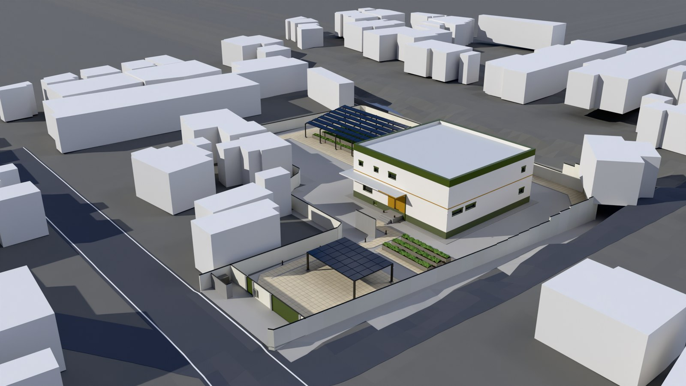
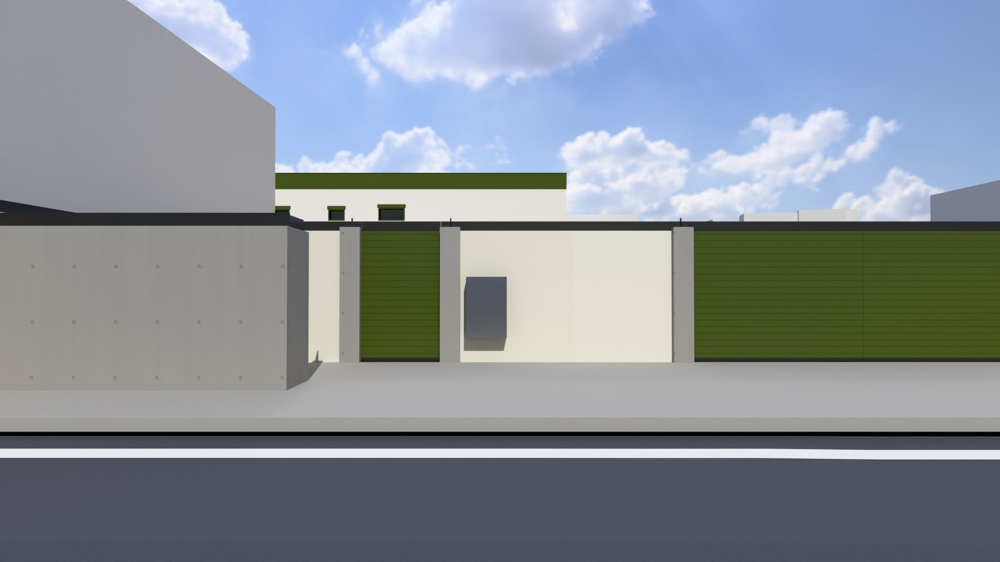

# 河沿要（仮称）設計ブリーフ v3｜敷地実測推定・外構方針 反映版

対象：東京都八王子市 大和田町7丁目（ひよどり山トンネル南口の西側、A3（エースリー）店舗・駐車場の土地）、壁式RC造 専用住宅（2階建て）
作成目的：v2 の仮定値（敷地約700m²・高低差）を、地図・航空写真・標高データによる推定値へ置き換え、外構（RC塀・透水・内水対策）方針を追加する。

## 0. v2 からの主な変更点

| 項目 | v2 | v3 |
|---|---|---|
| 敷地の範囲 | 「エースリー隣接エリア」約700m²（仮定） | **A3店舗敷地（A）＋西側駐車場（B）**（西側境界は施主加筆線） |
| 敷地面積 | 約700m²（不足 約18m²） | **約2,772m²（約839坪）**、推定誤差 ±5%程度（1.1 の方法による） |
| 高低差 | 北・東が低い（3〜4m） | **北・東が高い**。敷地は南側道路とほぼ同レベルで、周囲より低い側 |
| 造成 | 南側道路基準の切土（掘削3〜4m） | **切土・盛土なし**（現況地盤をそのまま利用） |
| 擁壁 | 北・東に新設RC擁壁＋離隔5.0m/2.0m | **新設不要の見込み**（建物を崖の高さの2倍以上離す。既存の護岸・道路擁壁は要調査） |
| 1階床高 | 南側道路面＋30〜45cm | **設計GL＋1,500**（敷地が低い位置にあるため引き上げ） |
| 駐車場 | 西側帯（車路3.0＋奥行5.5m） | **南側の帯状部分（南側道路の接道部）**に3台＋ソーラーカーポート、Dotcon+ 舗装 |
| 塀 | 北・東にH1.8m RC塀 | **敷地の全周にH2.0m RC塀（防犯）**。出入口には止水板 |

---

## 1. 敷地条件

| 項目 | 内容 |
|---|---|
| 所在地 | 八王子市大和田町7丁目（ひよどり山トンネル南口交差点の西、A3（住居表示 7-19-7）とその西側駐車場） |
| 敷地面積 | **約2,772m²（839坪）**（推定。実測図・登記地積による確定が必要） |
| 接道 | 南：幹線道路（幅員約7m、接道長 約13.9m）／東：トンネルへ向かう道路（幅員約5m、接道長 約81.8m、北へ上り勾配） |
| 北側境界 | 水路（南岸の水涯線に接する長さ 約82.3m）。水路の北側に幅員4m未満の道路（42条2項道路の可能性）。**水路を挟むため、敷地はこの道路に直接は接していない** |
| 高低差（実測DEM） | 敷地 TP+109.3〜109.6m（ほぼ平坦）／南側道路 109.0m／北側道路 112.5〜113.0m（**敷地より約3.2m高い**）／東側道路 109.0m（南端）→112.9m（北端） |
| 用途地域 | **準工業地域（建ぺい率60%・容積率200%）と推定**。遊技場が立地していること、7丁目の物件情報から判断。南・東の2道路の角地のため、角地緩和で建ぺい率70%の可能性あり。いずれも都市計画図での確認が必要 |
| 土砂災害区域 | 非該当（v2 で確認済み） |
| 洪水・内水浸水想定 | 0.5m未満〜0.5〜1.0m（v2 のとおり）。**敷地は北・東の斜面からの雨水が集まる低い側**にあり、内水対策の優先度は高い |

### 1.1 敷地面積の推定方法
- 国土地理院 基盤地図情報（ベクトルタイル、縮尺1/2500）の**道路縁・水涯線**を北・東・南の境界とした（位置精度 ±1.75m程度）。
- 西側境界は、標高109.6m の点（ローカル座標 -35, 10）を通り、西側駐車場の白線に平行な直線（北から約17°東、施主指定）。北西・南西は施主の加筆線を直線化（延長 計 約85m）。南西の一部（延長 約38m）は隣接住宅の外形から約1m離れた位置として推定（要測量）。
- 標高は国土地理院 5mメッシュDEM（DEM5A、航空レーザ測量）を使用。
- 法務局の地図XML（公図）は旧土地台帳附属地図で方位不明・位置が合わないため、面積の根拠には用いていない。
- 図：`docs/site_estimate.png`（赤実線＝地図と一致、橙実線＝施主加筆線、赤破線＝推定）

---

## 2. 建物配置と所要寸法（v2 の試算を置き換え）

| 項目 | 数値 |
|---|---|
| 建物外寸 | 17.74m角（v2 のとおり）。建築面積は壁芯（RC躯体芯 17.25m角）で **297.56m²**（v2 の 314.7m² は外寸による値） |
| 建物位置 | 敷地中央（A3 店舗跡の位置）。建物の各辺は東西南北にそろえる |
| 北側水路（崖下）までの離れ | 約11.1m（北側の崖の高さ 約3.2m × 2 ＝ 6.4m 以上） |
| 東側道路までの離れ | 約9.4m（道路との高低差 最大 約3.3m × 2 ＝ 6.6m 以上） |
| 南西の隣地までの離れ | 約7.7m |
| 建ぺい率／容積率 | 297.56/2,772 ＝ 10.73%／延べ 595.12/2,772 ＝ 21.47%（上限 60%/200% に対し大きな余裕） |

v2 で問題だった「約18m²不足」は解消する。東西寸法を決めていた西側の駐車帯は不要になり、駐車場は南側の接道部へ移す。

---

## 3. 地盤・造成・浸水対策

| 項目 | 内容 |
|---|---|
| 基準地盤面（設計GL） | **南側道路面（TP+109.0m）＝±0**（v2 と同じ） |
| 敷地の仕上げ地盤（FGL） | **GL＋450**（現況 TP+109.3〜109.6m を維持、切土・盛土なし） |
| 1階床レベル | **GL＋1,500**（想定浸水深 1.0m＋余裕。床下は設備ピット兼用の高基礎） |
| 北側処理 | 既存の水路護岸と北側道路の高低差（約3.2m）は敷地の外にある。建物は崖の高さの2倍以上離すため、**新たな擁壁は設けない**（東京都建築安全条例 第6条の確認と、既存護岸の調査が必要） |
| 東側処理 | 東側道路は北へ上る坂（敷地との差 0〜3.3m）。道路側の擁壁は既存の構造物とみなし、建物は離す。東面の塀は道路高さに合わせ、基礎の天端を段状に変える |
| 外周仕上げ | 腰壁（GL〜+1,500）は防水性を重視した仕上げ（タイル・石張り） |
| 排水計画 | 逆流防止弁、強制排水ポンプ（非常電源付き）は v2 のとおり。下記 3.1 の外構対策を追加 |
| 地盤調査 | ボーリング調査は必須（河川・水路に近接）。既存の店舗基礎・杭の撤去計画も必要 |

### 3.1 外構の内水対策（新規）
1. **RC塀の止水機能**：塀の基礎と下部（FGL＋600 まで）を止水構造とし、北・東の高い側からの表流水が敷地へ流れ込むのを抑える。門扉・車両出入口には着脱式の止水板（H600）を備える。
2. **透水性舗装**：駐車場（約3台分＋車路）に **Dotcon+**（600mm角、厚さ150mm、目地からの浸透、1m²あたり約13Lの貯留）を採用。アプローチ・通路も透水性舗装とする。
3. **雨水浸透・貯留**：西側の庭（旧 B 駐車場）に浸透トレンチ・浸透桝と地下貯留槽（容量は地盤調査の透水係数で決定。目安 20〜30m³）を設ける。地下水位が高い場合は貯留を主とし、浸透は補助とする。
4. **塀の排水口**：塀の低い位置に排水口を設け、外側にフラップ弁を付けて逆流を防ぐ。
5. 八王子市の雨水浸透施設の指導・助成制度の対象かどうかを確認する。

---

## 4. 外構・防犯（新規）

| 項目 | 内容 |
|---|---|
| 塀 | **RC造 H2,000（FGL基準）、厚さ150〜180**、敷地全周（出入口を除く）。風圧・地震に対して構造計算で安全を確認する（RC塀は令62条の8の対象外だが、同等以上の安全性を確保） |
| 出入口 | 南側道路：車両門扉（W5.0m）＋人用門扉（W1.2m）。（v4.10 で勝手口は廃止）旧: 東側道路の南端に勝手口（W1.0m）を設けるか検討 |
| 防犯 | 高い目隠し塀は、侵入された後に外から見えない死角にもなる。塀上部の侵入防止（忍び返し等）、センサーライト・防犯カメラ、門扉の高さを塀と同じにすることをあわせて計画する |
| 隅切り | 南側道路の幅員は6m以上と推定されるため、東京都建築安全条例第2条の隅切りは不要の見込み（要確認） |
| 水路沿い | 北側の塀は水路の管理境界から離して設置する（占用協議・境界確定に従う） |

---

## 5. 構造計画（v2 から変更なし、一部明確化）

| 項目 | 内容 |
|---|---|
| 構造形式 | 壁式RC造（純壁式） |
| 構造グリッド | 内寸17.0m角。壁芯で X1–X4／Y1–Y4 = 0／6,125／11,125／17,250（3スパン、内寸 6.0／5.0／6.0m 相当） |
| 壁厚 | RC250mm（外周・内部の耐力壁）。外断熱100mm＋外装20mm |
| 耐震壁 | 外周＋中央十字（X2・X3・Y2・Y3 通り）＋階段コア。1階と2階で同じ位置に配置 |
| スラブ厚 | 220mm |
| 階高 | 3.2m×2階（1FL＝GL＋1,500、2FL＝GL＋4,700、RFL＝GL＋7,900） |
| 基礎 | べた基礎＋地中梁（高基礎 GL＋1,500 まで立ち上げ）。杭の要否は地盤調査で判断 |

## 6. 温熱・空調計画／7. 外皮・開口部／8. 電力・太陽光
v2 の第5〜7章のとおり。ただし次の点を変更する。
- **ソーラーカーポート**：西側から**南側の駐車場上部**へ移す（屋根面積 約90m²・約17kWp は維持）。**住宅の屋根には太陽光パネルを設置しない**（v3.2、太陽光は駐車場のみ）。
- **採光補正係数 K=3.0**：準工業地域の算定式（敷地の余裕が大きい）で上限値が適用される見込み。確認が必要。

## 9. 諸室プログラム・グリッド配置（v3.1 で全面見直し）
施主指示（2026-10-03）により、v2 の部屋割り指示は採用せず、**回遊動線・家事動線・居室の防音**を優先して再計画した。構造グリッド（壁式RC、X2・X3・Y2・Y3 通りの耐力壁）は変更しない。

### 1階
| | 西 6.0m | 中 5.0m | 東 6.0m |
|---|---|---|---|
| **北** | ランドリー・室内干し 16.2m²／ファミリークローゼット 11.4m²／階段2 | 洗面・脱衣 6.5m²／浴室 9.4m²／トイレ／廊下 | 居室A 17.3m²／WIC 8.8m²／廊下 |
| **中** | キッチン 20.9m²／パントリー 6.5m²（通り抜け） | ホール・階段1／トイレ | 機械室（西系統・東系統）各 約8.6m²（ジムとの緩衝帯） |
| **南** | リビング・ダイニング 34.5m² | 玄関／ホール／SIC（通り抜け） | **ジム 45.7m²**（東セル＋中段の南側） |

### 2階
| | 西 6.0m | 中 5.0m | 東 6.0m |
|---|---|---|---|
| **北** | ファミリークローゼット 22.2m²／ホール・階段2 | 洗面・脱衣／シャワー／トイレ／廊下 | 主寝室 34.5m² |
| **中** | 図書室 27.9m² | ホール・階段1／トイレ | 前室（音響ロック）9.7m²／WIC（主寝室）17.6m² |
| **南** | 居室B 12.5m²／収納／居室C 11.9m² | 居室D 14.3m²／WIC | **シアター 34.5m²**（ジムの真上） |

### 計画の要点
- **回遊動線**
  - 1階は2つの周回ルート。①（家族）玄関ホール→LDK→キッチン→ホール→玄関、②（家事）キッチン→パントリー→ランドリー→洗面脱衣→廊下→ホール→キッチン。
  - 2階も2つの周回ルート。③ ホール→図書室→南廊下→ホール、④ ホール→洗面→階段2ホール→図書室→ホール。
  - 階段2か所で上下階も周回できる。
- **家事動線（洗う→干す→しまう）**: ランドリー・室内干しの隣にファミリークローゼット。階段2で2階のファミリークローゼットへ直結。パントリーはキッチンとランドリーの間を通り抜けられる。
- **防音ゾーニング**: 騒音源のジム（1階）とシアター（2階）を南東に上下で集約。主寝室・居室Aとの間には機械室・前室・WIC を緩衝帯として挟む。居室B・C・D の間仕切りには収納・WIC を充てる。ジムは浮き床と遮音ドア Ts-35、シアターは前室と両開き遮音扉 Ts-40。
- **ジム**: 従前 34.5m² の1.3倍の **45.7m²**。
  - 搬入: 南面の両開き搬入扉（W1,800×H2,400）の外に、1FL と同じ高さの**搬入デッキ**（3.0×3.0m）を設ける。トラックの荷台（高さ約1.0m）から段差なしで横付けでき、車路（Dotcon+ 舗装）が駐車場からデッキまで続く。
  - 構造: Y2 通りの耐力壁に幅5.2mの開口を設ける。2階の壁を壁梁として受け、壁量は 17.3cm/m² 以上（基準 12）を確保。
- **採光**: LDK はキッチンと幅4mの開口でつながるため一体の居室として扱う（55.4m²）。シアターは採光を求めない室（納戸扱い）とし、要確認。

## 9.1 開口部・排煙・ジム搬入（v3.2）
- **2階の窓**:
  - 1階と同じく全窓 FIX。樹脂枠、Low-E トリプル（アルゴン）＋合わせガラス（UVカット約99%）、Uw≦0.90 W/m²K。窓台は FL+1,000。
  - 採光は全居室で基準（床面積の15.29%、K=3.0）の1.10〜1.28倍を確保（図面 A-10）。
- **2階の排煙**:
  - FIX 窓の居室は「排煙上の無窓居室」になるため、**1階と同じ機械排煙**とする（居室B・C・D・図書室・主寝室）。
  - 高窓の一部を開閉式にする自然排煙案と比較した。開閉部が防犯・気密・断熱の弱点になるため不採用。
  - 排煙機は西・東系統の機械室に各 120m³/分×1台（最大区画 55.4m²×2 = 111m³/分以上を満たす）。
  - 排煙口は各居室の天井（最遠 約4.9m ≦ 30m）、手動開放装置は床から0.8〜1.5m。予備電源は蓄電池（駐車場PV と連携）。
  - 排煙時は機械室の給気ダンパーが連動して開く。
- **ジム開口部の改善**:
  - 南面の両開き搬入扉を廃止し、腰高窓2か所を FIX 高窓（2.1×0.6m×2、窓台 FL+2,000＝地盤から約3.05m）に変更。1階の窓はすべて防犯合わせガラス（CP 認定品）とする。
  - 開口面積は 7.32m² → 2.52m²、開口まわりの熱損失は 9.2W/K → 3.3W/K（約64%減）。
  - 採光は 7.56m²（必要 6.98m²）を確保。
- **玄関（v3.3）**: SIC は設けず、土間に造作の下足入れを置く。框は二重とし、土間 1FL-360 → 式台 1FL-180 → ホール 1FL の2段で上がる。外部階段は4段（FGL → ポーチ 1FL-380）。段差解消機は設けない。
- **ジムへの搬入（v3.3）**: 外部階段 → 玄関（W1,000×H2,300）→ 土間 → 二重框 → ホールで右折 → X3 通りの遮音ドア（W1,000×H2,300、Ts-35）→ ジム。
- **ジムの設備（v3.3）**: エニタイムフィットネス等の商業ジムに配備されるマシン相当を想定する。パワーラック＋デッドリフト台、トレッドミル×2、クロストレーナー、ダンベルラック、ベンチ、ラットプル・ロー、レッグプレス、ケーブルクロスオーバー、ストレッチマット（計約2.5t）。
  - トレッドミル後方に2.0mの安全帯を確保する。
  - 1台ものの大型マシンは、メーカーの分解搬入（幅1m以下の部材に分ける）を前提とする。
  - 床は設計用積載荷重 5,000N/m²（提案）とし、浮き床にする。落下エリア（デッドリフト台）は補強する。

## 10. 音響・遮音計画
v2 のとおり。

---

## 10.1 図面・3D
本ブリーフに基づく基本計画図（DXF/PDF 17枚）、法規チェック（59項目）、3Dモデルは `rc-building/` に生成（`python3 src/build.py`）。

## 12. v4 変更（B案: 内寸18.0m角）・冷暖房負荷・耐震性・必要発電量
施主決定（2026-10-04）により、内寸を17.0m角から **18.0m角** に拡大する。増えた1mは**中央スパン**に充てる（B案）。

### 12.1 構造グリッド
| 項目 | v3 | v4（B案） |
|---|---|---|
| 壁芯グリッド X1–X4／Y1–Y4 | 0／6,125／11,125／17,250 | **0／6,125／12,125／18,250**（6.125／6.0／6.125） |
| 内寸／外寸 | 17.0m／17.74m | **18.0m／18.74m** |
| 建築面積（壁芯）・延べ面積 | 297.56m²・595.12m² | **333.06m²・666.12m²** |
| 建ぺい率／容積率 | 10.73%／21.47% | **12.01%／24.03%** |
| 離れ（北 水路／東 道路／隣地） | 11.1／9.4／8.1m | 10.0／8.4／8.1m（がけ条例の2H 6.4m／6.6m 以上） |

耐力壁の位置（外周＋X2・X3・Y2・Y3 通り、1・2階で同じ位置）は変えない。

### 12.2 間取りの変更点（中央スパン 5.0→6.0m の使い道）
- 玄関土間・式台の幅は5.75m。下足入れに加えて腰掛けベンチを置く。
- 階段1は有効幅 950→**1,150mm**、踏面 240→**260mm**。
- 中央のトイレは 1.9→**3.9m²** で、手洗いを付ける。
- **ジムは 51.6m²**（当初34.5m²の1.49倍）。奥行を8.8mに延ばし、機械室の奥行も3.0mを確保した。
- 2階は図書室 33.8m²、居室D 17.1m²、主寝室WIC 22.3m²。

### 12.3 冷暖房負荷（概算、図面 M-01）
| 項目 | v3 | v4 |
|---|---|---|
| UA（W/m²K） | 0.209 | 0.207 |
| 暖房 設計負荷 | 8.6kW | **9.4kW** |
| 冷房 設計負荷（顕熱＋潜熱） | 12.7kW | **13.3kW** |
| 除湿／加湿（ピーク日） | 76／62 L/日 | 85／69 L/日 |

- 床面積は+12%だが、外皮の増加は+9%にとどまる。UA は変わらず、負荷の増加は換気量（容積）の増分に相当する。
- 空調機は西系統（5.6kW級）と東系統（7.1kW級。ジム・シアターの発熱を見込む）の2系統、全館空調＋デシカント調湿とする。

### 12.4 耐震性（概算、図面 S-03）
- 建物重量は約9,184kN（13.8kN/m²）。
- 壁のせん断応力度は、耐震等級3相当（Co=0.3）でも短期許容値の**5.5倍以上**の余裕がある。
- 壁量は 16.6〜19.1cm/m²（基準12）、耐力壁で囲まれた面積は最大37.5m²（上限60）。
- 偏心率は最大0.105（ジム開口の影響、上限0.15）。
- 接地圧（長期）は42kN/m²。
- B案でも壁式RCの規定を満たし、耐震等級3の取得は十分見込める（品確法の評価・構造計算で確定）。
- ジムの床スラブ（積載5kN/m²）の必要厚は約193mmで、t=220 で可。

### 12.5 必要発電量（太陽光は駐車場のみ、図面 M-01）
- 年間電力需要は約**21,902kWh**。暖房・冷房・調湿・全熱交換換気・給湯・照明・家電・ジム・シアター・待機電力を含む。v2 の想定（約13,000kWh）より大きい。
- 必要な容量は 20.9kWp。劣化・天候の余裕20%を見込むと **25.0kWp**。
- ソーラーカーポートを 9×10m（90m²、約17kWp）から **12×11m（132m²、約25.1kWp、年 約26,334kWh）** に拡大する。
- 蓄電池は、停電時の排煙機30分＋排水ポンプ6時間＋最低限の生活24時間で 約15.7kWh（v4.22 までは 16kWh 級）。v4.23 で「理論上1週間」に改め **200kWh 級**（31章）。

## 13. v4.1 変更: 室内環境目標と太陽光の設置場所
### 13.1 室内環境目標（全室・通年）
| | 温度 | 湿度 | 絶対湿度 | 露点 |
|---|---|---|---|---|
| 夏 | 25〜26℃ | 55〜60% | 10.9〜12.6g/kg | 15.3〜17.6℃ |
| 冬 | 20〜21℃ | 55〜60% | 8.0〜9.3g/kg | 10.7〜12.9℃ |

- 第5章の目標（夏26℃/45%・冬22℃/60%）を置き換える。
- 負荷計算は、負荷が最大になる側で行う（冬は21℃/60%、夏は25℃/55%）。
- 負荷の比較（旧目標 → 新目標）:
  - 暖房: 9.4 → **9.0kW**
  - 冷房（顕熱＋潜熱）: 13.3 → **13.4kW**
  - 除湿: 85 → **74L/日**
  - 加湿: 69 → **63L/日**
- 湿度の幅（55〜60%）が狭いため、各系統に全熱交換＋デシカント調湿を設け、室ごとの湿度センサーで制御する。
- 冬の窓の室内表面温度は約18℃で、室内の露点（12.9℃）を上回るため結露しない。

### 13.2 太陽光は「日よけ付き菜園（ソーラーパーゴラ）」に設置
- 本館と構造的に分離した独立架台とする。西側の庭に 18×10m（180m²）、鉄骨、軒高2.8m、南向き10°。
- パネルは列状にすき間をあけて並べ（被覆率70%、パネル126m²）、光と雨を下の菜園に落とす。営農型太陽光（ソーラーシェアリング）やソーラーパーゴラとして実例がある。
- 下は半日陰向けの作物（葉物・ハーブ・ミョウガ・シソ・ベリー類）を育てる菜園・庭とする。
- パネルの雨水は雨どいで地下貯留槽（25m³、v4.23 でパーゴラの下へ移設。31章）へ集め、散水に使う。
- 発電容量は **27.1kWp、年 約28,444kWh**。年間電力需要 約21,462kWh の133%で、余裕20%を含む必要量 24.5kWp を満たす。
- 駐車場は屋根なし（Dotcon+ 舗装）とし、ソーラーカーポートは取りやめる。
- 屋根と柱をもつため建築物として扱われる見込み。建築面積に算入し（建ぺい率 約18.5%）、確認申請が必要。
- 建物の影（高さ8.5m、パーゴラまで東へ約9m）の影響は朝の一部に限られる。発電量シミュレーションで確認する。

## 14. v4.2 変更: 3台用ソーラーカーポートの併設・玄関の目隠し
### 14.1 発電設備（パーゴラ＋カーポート）
- パーゴラの損失（被覆率70%による減少分と建物の影）を補うため、**3台用ソーラーカーポート**（8.8×6.1m＝54m²、10.2kWp）を併設する。
- 影損失は、各月21日・30分ごとの太陽位置で本館・塀・隣家（高さ6.5m仮定）の影を追跡して算定した。
  - パーゴラ: **0.9%**（冬の朝に本館の影。12月は直達日射の約5%）
  - カーポート: **1.7%**
- 被覆率による減少分は約12,191kWh、影による損失は約269kWh。カーポートの年 約10,528kWh でその84%を補う。
- 合計は **37.3kWp・年 約38,703kWh**（需要 約21,462kWh の180%）。余剰は売電、または将来のEV充電に充てる。
- 建ぺい率はパーゴラ・カーポートを含めて約20.4%（上限60%）。

### 14.2 玄関の目隠し（v4.3 で見直し）
目標は「**南側道路から目視（目線1.5m）で玄関ドアが見えない**」こととする。v4.2 の囲い（南・東・西の壁と袖壁、延長16.6m、格子庇、クランク状のアプローチ）は閉塞感が強すぎるため撤去し、次のとおりとする。
- **自立壁1枚**: 長さ4.4m・高さ2.7m（FGL基準）・厚さ180のRC壁を、玄関階段の下端から3.4m南に置く。壁の延長は16.6m→4.4m（−73%）。
- **東西は開放**: 玄関まわりに光と風が通る。アプローチは西から壁の内側をまっすぐ進む。
- **構造の分離**: 本館・ポーチとは基礎から縁を切った独立基礎（RC塀と同じ断面、離隔1.5m以上）とし、単体で補修・更新・撤去ができる。
- **玄関庇**: 出2.0m×幅3.6m、1FL+2,500。本館からの片持ちRC庇とする。
- **視線の判定**（南側道路沿い17地点、玄関ドアの9点を対象）:
  - 壁がない場合: 9地点で見える
  - 計画: **0地点**（目線1.5m）
- **見える場合が残る条件**: 目線4.5m（バス・トラックの運転席、向かいの2階）からは、ドアの上部が見える。東側の高い道路の一部や隣地からも、斜めに見える地点が残る（施主の条件の対象外）。

## 15. v4.4 変更: 建物・外構を南側道路に平行・直交させる
- 南側道路の道路境界線は、真東西から **12.3°** 傾いている。建物（構造グリッド）・ソーラーパーゴラ・カーポート・目隠し壁・駐車場・アプローチを、すべてこの線に平行・直交させた。
- 南面は真南から12.3°西を向く。図面は建物の軸を上下・左右にそろえて描き、方位記号で真北の振れを示す。
- 回転後の離れ: 北（水路）11.0m、東（道路）10.0m、隣地 9.8m。いずれも がけ条例の2H（6.4m・6.6m）以上。
- 外構の再配置:
  - 駐車場とカーポートは南側の帯状部分の東寄りに置いた。
  - 人用門扉から東側を通るアプローチを設けた。
  - 雨水トレンチ・浸透桝・排水口は、回転後の西・北の庭に置き直した。
- 目隠し壁は L3.8m×H2.7m とし、玄関階段の下端から3.9m南に置いた。v4.3（L4.4m・3.4m）より短く、玄関から遠い。南側道路沿い17地点のすべてで、目線1.5mから玄関ドアは見えない。
- **日射取得の再計算**（真北基準 → 道路基準）:
  - 窓の日射取得: 暖房期 839 → 842kWh、冷房期 822 → 829kWh。東面は冬に増え、西面は減る。
  - 冷房ピークの窓日射取得: 1.32 → 1.25kW。年間暖房熱量: 17,907 → 17,904kWh。
  - 太陽光の年間日射: パーゴラ -0.14%、カーポート -0.05%。
  - 影損失: パーゴラ 0.67%、カーポート 1.21%。
  - 合計発電量は 年 約38,788kWh（需要 約21,106kWh の184%）。
  - 結論: 窓が小さい FIX 窓中心の外皮のため、12°程度の振れによる影響は無視できる程度。
- 3Dモデルは真北基準で出力する（建物が12.3°振れた状態で表示される）。

## 16. 窓仕様と紫外線対策（v4.5）

施主指示: 日照による紫外線をカットする設備を設ける。すべての窓を Low-E ガラスのトリプルサッシとする。

- **窓（全12か所・すべて FIX）**: 樹脂サッシ＋Low-E トリプルガラス（アルゴン、Low-E 膜2面）、Ug 0.60・Uw ≦0.90 W/m²K。
  - 1階: 室外側 UVカット防犯合わせ（CP）8.8 + Ar16 + 4 + Ar16 + Low-E 5
  - 2階: 室外側 UVカット合わせ 6.8 + Ar16 + 4 + Ar16 + Low-E 5
  - 南・北は日射取得型（g 0.45）、東・西は遮熱型（g 0.28）
- **紫外線カット設備**
  1. 全窓の室外側を UVカット中間膜の合わせガラスとし、紫外線を約99%カット（透過率1%以下）。
  2. 南・東・西の窓11か所に**外付け電動スクリーン（ZIP型）**（両側レールで生地を保持、日射・風センサー連動）。5〜9月は自動で下ろし、冬は上げて日射を取り込む。ボックス（H200×D150）は窓上の外断熱層に埋め込む。v4.6 で羽根のあるブラインドから変更（17章の清掃性の方針による）。
  3. 屋外は玄関庇（出2.0m）・ソーラーパーゴラ・カーポート屋根が日よけを兼ねる。
- **効果（概算、M-03）**
  - 窓面に当たる紫外線 年 約379kWh → 室内に入る紫外線 約2.4kWh（99.4%カット）。合わせなしの Low-E トリプルでは約57kWh（85%カット）。
  - 冷房ピークの窓日射取得 1.25kW → 0.29kW、冷房顕熱の設計負荷 10.59kW → 9.63kW。
  - 暖房期の窓日射取得 842kWh → 1,053kWh（南面を日射取得型にした効果）、年間暖房熱量 17,904kWh → 17,714kWh。
  - 年間電力需要 約20,859kWh、太陽光発電 約38,788kWh（需要の186%）。
- ガラスの紫外線透過率・日射熱取得率・スクリーンの遮蔽係数は代表値。実施設計でメーカー値により確定する。

## 17. インテリアの一貫方針（v4.6）

施主指示: インテリアは一貫して「**すばらしいデザインは安全であるべき**」「**清掃とメンテナンスが簡易であるべき**」を重視する。子どもが頭を挟むおそれのある形、おしゃれだが頻繁な手入れが必要な形は採らない。

- **意匠の考え方**: 見た目のための凹凸（オープン棚（v4.17: キッチン・パントリーは施主指示により全露出、27章）・間接照明の溝・格子・スリット・手すり子）は、危険またはほこり溜まりになるなら採用しない。意匠は素材の質感・色・光でつくる。
- **安全（I-01）**
  - 頭部・指の挟み込み: 床から1.8m以内に 100〜230mm（頭）・8〜25mm（指）のすき間をつくらない。階段まわりは手すり子・横桟のないパネルの手すり壁とする。
  - 転落: 窓は全て FIX、吹抜けなし。2階の階段開口は H1,100 の手すり壁3か所（端部は壁に接し、すき間 0）。上下の階段の間の壁は 2FL+1,100 まで連続させる。
  - 階段: 階段1 R177.8/T260（2R+T=616）、階段2 R177.8/T240（596）、勾配6/7以下、蹴込み板あり（品確法 高齢者等配慮 等級5相当）。
  - 指はさみ防止金物・上吊りソフトクローズ引戸・非常解錠錠・浴室扉の補助錠（H1,400）・シャッター付きコンセント・IH チャイルドロック・サーモ水栓。
  - ひも: 室内にブラインド・カーテンのひもを使わない（日射・紫外線は外付けスクリーンで制御）。
  - ジムは暗証番号錠、機器は自重・広い脚で安定させる（床・壁に穴をあけない）。機械室は施錠。収納・本棚は突っ張り式とし、可動はしごは設けない（v4.7）。
- **清掃・メンテナンス（I-01・I-02）**
  - 継目の少ないノンワックス床、水回りはシームレスシートで巾木まで一体。床清掃は掃除ロボット（v4.7、18章）。
  - 薄型ソフト巾木（入隅一体）、拭き取れる耐汚染塗装、汚れやすい所は目地のない化粧パネル。
  - フラット天井・埋込 LED、収納は扉付きで天井まで、下足入れは台輪で床まで塞ぐ（v4.16 で統一。要施主確認）。
  - タンク式便器（フチなし・防汚、v4.7）、一体成形カウンター・シンク、浴室乾燥機。
  - 窓は FIX で網戸なし、室外側ガラスは親水コーティング、2階外側は地上から水洗いポールで清掃。
  - 外付けスクリーンは羽根のない ZIP 型。全館空調のフィルターは床から手の届く高さ。
- 各室の仕上げは I-02 内装仕上表に示す（品番・数量は実施設計で決める）。

## 18. 家具・清掃ロボット・設備制御・Wi-Fi・防虫（v4.7）

- **家具の転倒防止**: RC 壁には固定しない（外断熱の躯体に穴をあけない）。背の高い収納・本棚は床と天井の間の突っ張り（天井下地を補強）と、幅広の脚・背面連結・低重心（重い物は下段）・耐震ラッチの構造で倒れにくくする。
- **床清掃は掃除ロボット**: 各階1台、ドックは1階ランドリー・2階ファミリークローゼット（自動ゴミ収集・給排水直結）。清掃範囲は 1階 約247m²・2階 約276m²。
  - 引戸の床レールは可。ただし段差は5mm以下にする。床に配線を這わせない。
  - 家具は台輪で床まで塞ぐか、脚下250mm以上にする（ロボットが入れ、子どもの頭が挟まらない寸法）。黒い床・敷物は避ける。
- **便器**: タンク式（タンクレスにしない）。
- **制御（bot 連携）**: 外付けスクリーン11台・照明・全館空調・掃除ロボットを KNX／Matter／ECHONET Lite でつなぎ、ゲートウェイのローカル API（認証付き）から bot で操作する。強風・凍結・火災・停電時の自動制御と手元スイッチが bot の指令より優先。
- **照明**: 全室 調光・調色 LED（2200〜5000K）。時刻スケジュールで自動変化（夜間 2200K・10%、朝 3000→5000K、昼 5000〜4500K・100%、夕方から 3000→2200K）。室ごと・bot で変更できる。
- **Wi-Fi**: Wi-Fi 7 の天井 AP を各階6台、PoE＋の有線で機械室（東系統）のラックに集める。壁の減衰（RC 25dB）込みの概算で、5GHz 受信 -67dBm 以上が 1階 99.8%・2階 98.6%、-75dBm 未満の場所なし（E-01）。竣工時に実測で確認する。
- **外構の防虫（E-03）**
  - 外構照明13台を 2200K・下向き（全カットオフ）・人感センサーにする。北側（水路側）には照明を設けず、玄関ドアの真上・窓際にも光源を置かない。
  - 日没後は外付けスクリーンを自動で下ろし、室内の光を漏らさない。
  - たまり水をつくらない: 貯留槽は密閉し防虫網を付ける。樋は勾配をとり、舗装は透水性にする。
  - 建物まわりに防草砂利帯（幅1.0m）を設ける。堆肥は密閉式コンポスト、生ごみは蓋付きの保管庫に入れる。給排気フードには防虫網を付ける。

## 19. 門の後退・ゴミ収集ボックス・駐車場の移動（v4.8）

- **門の後退**: 南側の門（人用・車両）を道路境界から 4.0m 後退させた。南側道路沿いには塀を設けず、後退した「門の線」に塀と門扉を設ける。門の前は車1台分の待避・ゴミ出しのスペース（透水性舗装）になる。
  - 人用門扉 W1.2m、車両門扉 W5.0m。両門扉の間は 6.8m。
- **ゴミ収集ボックス**: W1.6×D0.8×H1.2m（金属製・密閉型の置き型）。門の外の、人用門扉と車両門扉の中間に置く。収集作業者は門を通らずに出し入れできる。
  - ボックスの前 1.25m に自立目隠し壁 L6.2m×H1.8m（RC・独立基礎）を立て、東端に北へ 1.0m の袖壁を付けた L 形とする。西端から回り込んで出し入れする。
  - 南側・東側道路の 184地点（目の高さ1.5m・門扉を閉じた状態）から確認し、ボックスが見える地点は 0。道路からは壁しか見えず、ボックスの存在はわからない（A-02D）。
- **駐車場**: 3台用ソーラーカーポートを 8.0m 北へ移した。門からカーポートまで約 8m の前面通路で、車の出し入れに使う。カーポートの影損失は 1.04%、年間発電量は約 38,805kWh（需要の186%）。
- **アプローチ**: 人用門扉 → カーポートの西 → 玄関の目隠し壁の東を回って玄関へ。
- **玄関の目隠し壁**: 門の後退でできた斜めの視線を切るため、L3.8m を L4.0m（X 8.1〜12.1m）に延ばした。南側道路から玄関ドアが見える地点は 0 のまま。

## 20. 菜園まわりの透水設備（v4.9）

- 菜園まわりの透水設備は全て Dotcon+ とした。浸透トレンチ（北・西）と菜園近くの浸透桝はやめ、同じ位置に幅2.0m の Dotcon+ の帯を設ける。
- ソーラーパーゴラの周囲 1.5m と畝の間の通路も Dotcon+ とする（畝は土のまま）。菜園まわりの Dotcon+ は約324m²。
- Dotcon+ の合計は約496m²（駐車場・門前 約173m²＋菜園まわり 約324m²）。一時貯留は約6.5m³（13L/m²）。地下貯留槽 25m³ は残し（v4.23 でパーゴラの下へ移設）、菜園の散水に使う。

## 21. ゴミ置きの位置変更・勝手口の廃止・車両盗難対策（v4.10）

- **ゴミ収集ボックス**: 施主スケッチにより、門の外の西の角へ移した。W0.8×D1.6×H1.2m、扉は東向き。v4.11 でさらに南へ寄せ、南の目隠し壁から 0.1m の位置に置いた。
  - 南に自立目隠し壁（西の塀から X12.2m まで、H1.8m）を立て、東端に北へ 0.6m の短い袖壁を付ける（v4.11 で 1.5m から短縮）。袖壁と門の塀の間は約1.86m で、出し入れしやすい。
  - 南側道路の正面からは壁しか見えない。南東の角（東側道路の南端付近）の8地点（184地点中）から、斜めにボックスの一部がわずかに見える（施主了承）。
- **人用門扉**: 東へ移した（X12.4〜13.6m）。アプローチは門を入ってすぐ西へ寄せ、西の塀沿いを北へ進む（カーポートの西）。
- **勝手口**: 防犯性能を下げるため廃止した。出入口は南の人用門扉・車両門扉の2か所のみ。
- **車両盗難対策**
  - 門: 電動スライド門扉 H2.0m（目隠し・施錠・開閉センサー・こじ開け検知）。停電時は内側からのみ手動解錠できる。
  - 電動昇降ボラード: 車両門扉の内側に3本（φ220・地上高800）。夜間・不在時は上げ、門扉を壊されても車を出せないようにする。人・車を検知している間は上げない。
  - 駐車: 前向き駐車とし、CAN 配線の多いヘッドライト側を敷地の奥へ向ける（CAN インベーダー対策）。
  - 鍵: 電波遮断キーボックスを玄関ホールの収納内（外壁から5m 以上・RC 壁の内側）に置く（リレーアタック対策）。
  - 監視: 赤外線カメラ（940nm の不可視光で虫を寄せない）を門・カーポートに各2台。塀の内側に赤外線ビームセンサー。異常時は bot へ通知する。

## 22. 強盗（闇バイト型）対策の強化（v4.12）

これまでの構成（RC 塀 H2.0m、門の後退、全窓 FIX、勝手口なし、カメラ・ビームセンサー）は「侵入しにくい」点では強いが、押し入り強盗の手口（業者を装って玄関を開けさせる、在宅中に押し入り住人を拘束する、通信を切る）への備えが足りなかった。次を追加した（S-04）。

1. **門で応対する**: 人用門扉の西にカメラ付きインターホン、門の塀に貫通型宅配ボックス（外から入れて内から取る）。訪問者は玄関まで来させず、門も開けずに荷物を受け取る。
2. **乗り越えさせない**: 塀・門扉の天端と、ゴミ置きの目隠し壁など足がかりになる物の上に忍び返し。塀ぎわに木・物置を置かない。
3. **破らせない**: 2階の窓も CP 防犯合わせガラスに統一（全窓 CP）。玄関ドアは CP 防犯扉・2ロック・電気錠・ガードアーム。雨どいは外壁内に納め、屋上の点検口は内側から施錠する。
4. **すぐ知らせる**: ガラス破壊センサー、寝室・LDK・避難室の非常ボタン（無音通報）、機械警備（在宅時も夜間は外周警戒）。通報は有線＋LTE の2回線とし、蓄電池から給電する。
5. **逃げ込める**: 2階 WIC（主寝室、窓なし・RC 壁）を避難室とする。鋼製防犯扉・内締り・非常ボタン・予備通信を備え、警察の到着まで籠城できる。
6. **住まい方**: 現金・貴金属を多く置かない（置く場合は避難室の床に固定した耐火金庫）。知らない訪問者には門のインターホン越しに応対する。予定や在宅状況を SNS に載せない。

## 23. Blueprint 型の暮らしへの対応（v4.13）

- **寝室は1部屋に1人**（居室A〜D・主寝室）。
- **寝室の空気**: 基本の換気（0.5回/h）のままでは、小さい寝室で就寝中の CO2 が約1,040〜1,320ppm になる。寝室ごとに CO2 センサーで換気量を自動で増やし（1人 約37m³/h）、全寝室で 800ppm 以下とする。冷暖房の増加は全熱交換で回収し、年 約150kWh。給気フィルターは ePM1 70%以上。CO2・PM2.5・VOC センサーを各寝室と LDK に置く。
- **睡眠**: 寝室の外付けスクリーンは完全遮光の生地とする。温度は室ごとに設定できる（初期値は全室目標の下限、±2℃）。夜は照明 2200K・10%以下にし、寝室の Wi-Fi AP は表示灯を消して電波を止める。
- **水**: 家全体の浄水フィルター（機械室）と、台所に逆浸透膜（RO）浄水器を設ける。
- **菜園**: 基本はプランターとする。
  - 建物の南（X14.5〜23.5m・Y−9.5〜−3.5m）に日なたのプランター菜園（植付 約21.6m²、直達日射の影損失 年2.1%）を設け、Dotcon+ の上に脚付きプランターを並べる。アブラナ科・トマトなど日なたを好む作物はここで育てる。
  - パーゴラの下は半日陰（直達日射 約3割）のため、葉物・ハーブ・しょうがなどを育てる。
  - **床（基礎）の劣化を抑える**: 土・肥料・水を床に直接触れさせない（脚で 100mm 浮かせ、受け皿を置かない）。将来 RC 土間の上を農場にする場合は、t150・水セメント比45%以下・かぶり50・浸透性吸水防止材・勾配1/100とし、土は防水ライナーと排水層で床から絶縁する。
  - 土は購入した培養土を使う（旧店舗跡地の土は検査するまで使わない）。
- **運動・測定**: ジムに測定コーナー（体組成計・血圧計）を設け、睡眠・活動の記録を bot に集約する。エピゲノム検査は小平の医療機関で定期的に受ける。
- **サウナ**: 設けない。

## 24. 敷地境界・塀の再配置と Dotcon+ の配置（v4.14）

施主の再配置図による。
- **境界・塀**: 北側は塀が水路（雨水の溝）の際に近かったため、境界・塀を約1〜2m 内側へ寄せた。東側は東側道路との角度を調整し、1本の直線にした。北東の角（急傾斜で、パチンコ店への通路だった部分）は不要と判断し、多めに切り欠いた。
  - 敷地は約2,630m²（再配置前 約2,772m²）。建ぺい率 12.7%（パーゴラ・カーポートを含めて 21.6%）、容積率 25.3%。
  - がけ条例の離れは、北が水路側の境界まで 9.9m、東が 10.0m（必要 6.4m・6.6m）。
- **Dotcon+ の配置**（合計 約838m²、一時貯留 約10.9m³）
  - 駐車場とアプローチ（約213m²）。
  - パーゴラの下全体と、北・西の帯。
  - 北東〜東の帯。北・東の高い側から流れ込む表流水を受ける。
  - 日なたのプランター菜園。
- パーゴラの下も畝ではなく脚付きプランターとする（床を傷めない、23章）。
- 門前の広場（門の外）は再配置図で Dotcon+ に含まれていないため、Dotcon+ から外した。
- 再配置で、南側・東側道路沿いの見通しの判定点は 184 から 158 に減った。ゴミ収集ボックスの一部が見えるのは、南東の角の7地点。

## 25. 外装・外構の色とマテリアル、外観CG（v4.15）

施主の指示（2026-10-23）による。**色の値はいずれも仮定**で、実物の見本板で確認する。

### 色の3区分と割り付け（ベース：アソート：アクセント ≒ 70：25：5）
| 区分 | 色 | 使う部位 |
|---|---|---|
| ベース `#F5EFE3` | 一般部の外壁（1FL〜RFL−300）、窓の抱き | 外装塗装（微弾性・つや消し、砂骨の塗り肌）。約70% |
| アソート `#4F5B2A` | 腰壁（FGL〜1FL、二丁掛タイル・目地 `#8E8A7E`）、頂部帯（RFL−300〜パラペット天端）、アルミ笠木、ZIPスクリーンのボックス、窓枠、門扉 | 約26% |
| アクセント `#B8892D` | 玄関扉、玄関まわり（南面 x7,300〜10,900・庇の下）、玄関庇、2FL の水平見切り | 約4%。玄関の位置を示す |

腰壁は図面上「GL〜+1,500」とあるが、FGL(+450)〜1FL の帯と解釈した。外壁の不透明な面積の比率は、モデルから集計して 70.0：25.8：4.1 である。

### 塀と Dotcon+
- 塀は指定範囲 `#FFF8F0`〜`#ECE7D1` の中から、基準色 `#F0EAD7`（範囲の 80%）とした。外壁のベースより少し黄みが強く暗いので、建物と塀が一体に溶けず、系統はそろう。
- 2m ごとの区間を、5段階（`#F2ECDA` `#F1EBD8` `#EFEAD7` `#EEE9D5` `#EDE8D3`）にハッシュで振り分け、塗りの個体差を出す（再現できる）。
- Dotcon+ は指定の `#D8C9A8`（600角・目地10）。

### 「指定のない面はコンクリート」の適用
| 区分 | 部位 | 材料 |
|---|---|---|
| コンクリート | 門柱、玄関の目隠し壁、ゴミ置きの目隠し壁・袖壁、独立基礎の台座、ボラードの台座、Dotcon+ の見切り（幅100）、水路の護岸 | RC 打放し（撥水クリア、型枠目地 0.9×1.8m・セパ穴あり） `#A8A49B` |
| コンクリート | 外部階段・玄関ポーチ | 金ごて＋刷毛引き（滑り止め） |
| コンクリート | **仕上げの決まっていない地面**（敷地の地面、門前の広場） | **透水性コンクリート** `#B3AFA6`（ダミー目地3m）。**要施主確認** |
| 製品・設備（コンクリートでは成り立たないので、マテリアルは仕様者が決定） | 門扉、忍び返し、ボラード、照明、カメラ、宅配ボックス、ゴミ収集ボックス、架台、プランター | アルミ焼付塗装（アソート色）、スチール黒、ステンレス、溶融亜鉛めっき鋼＋焼付 ほか |
| 指定あり | 建物まわりの防草砂利帯（幅1,000、ブリーフ18章の防草方針） | 砕石 5〜13号 `#B5B0A5` |

指定のない地面を透水性コンクリートとしたのは、施主の指示と、ブリーフ18・19章の「舗装は透水性」の方針を両立させるための仕様者の判断である。**施主の確認が必要**。

### 外観CG（7カット）
| カット | 確認すること |
|---|---|
| C01 南側道路から門まわり | 門扉（閉）・門柱・塀の個体差、ゴミ置き目隠し壁、宅配ボックス。玄関が見えないこと |
| C01b 南東角からの確認 | ゴミ収集ボックスが袖壁と目隠し壁でほぼ隠れること（24章と整合） |
| C02 南東上空からの全景 | 配置、屋上の防水層と笠木、パーゴラ・カーポートのパネル、Dotcon+ の配置 |
| C03 アプローチから玄関 | 庇・扉・玄関まわり（アクセント）、オリーブ色の腰壁タイル、外部階段 |
| C04 西の庭のパーゴラと菜園 | 柱・梁・母屋とパネルの帯状の影、脚付きプランター |
| C05 東側道路から建物と塀 | 坂道の路面、段状の塀の天端と、その上の2階・頂部帯 |
| C06 夕景 | 2200K の外構照明（下向きで足元だけ）、窓の室内の灯り。玄関扉の真上と北側に光源がない |

- 作り方: GLB から Blender の Python モジュール（bpy 5.0）で場面を組み、Cycles（CPU）で描画する。テクスチャと空（HDRI）は Poly Haven（CC0、帰属表示は不要）から実行時に取得して `.cache/cg/` に保存する（リポジトリには入れない）。取得できなければ手続き生成に切り替える。写真ではなくシミュレーションであり、色は仮定である。
- 再生成: `python3 -m venv .venv-bpy && .venv-bpy/bin/pip install bpy==5.0.1`（初回のみ）→ `python3 src/render_cg.py`。構図の確認は `--preview`。

## 26. 内装の仮置きと内装CG（v4.16）

**家具は仮置き（後日差し替え）です。指定商品2点の寸法・色は仮定（商品ページ未確認）、色はいずれも仮定です。**

### 26.1 施主の指示
- リビング（LDK）のチェアは1脚だけ。商品は「ペッパー スクールチェア チャコールブラウン」。それ以外の部屋にチェア類（椅子・ダイニングチェア・ワークチェア・スツール）は置かない。
- リビングテーブルは「マテリア ダイニングテーブル OSB 177.5cm ロの字脚 ブラック(スチール) カラー:ステンレス」を仮置き。
- そのほかの内装は仕様者に一任。家具の配置は図面 I-03（1階）・I-04（2階）、家具表と内装色彩計画は I-05、実装は `src/furniture.py`、商品と切替は `spec.yaml` の `furniture`。

### 26.2 指定商品2点の仮定（要施主確認）
商品ページは見つからなかったため、日本の同種商品の一般的な寸法を仮定した。商品ページの URL か型番をいただければ、`furniture.products` の値だけを直せば図面・CG・家具表が更新される。

| 商品 | 仮定 | 要確認 |
|---|---|---|
| OSB テーブル | W1,775（商品名）×D850×H720。天板 OSB t30・クリア塗装。ロの字脚2組（□40 の角パイプ・黒の粉体塗装、天板端から100内側）。**「カラー:ステンレス」は天板の木口に巻いたステンレス縁と解釈**（ほかの解釈: 脚がステンレス／天板の色名がステンレス。`stainless_part: legs / top` で切替） | 奥行・高さ・厚さ・角パイプ寸法、「カラー」の意味 |
| スクールチェア | W420×D480×H780、座面高450。鋼管 φ22 のフレーム、成形合板の座面・湾曲した背板。座・背はチャコールブラウン `#4A3F38`、フレームは暗褐色 `#2B2622` | 寸法、形、フレームの色（チャコールブラウンか）、木部の色（ナチュラルか） |

### 26.3 座る家具の扱い（要施主確認）
施主の「チェアは LDK に1脚」を守り、ソファ・ベンチは「チェアではない」と解釈して次のとおり置いた。`furniture.optional_seating: false` で、シアターの箱型ソファ（TH-F）・図書室の窓下ベンチ（LB-B1）・玄関の腰掛けベンチ（G-B1）をまとめて外せる（玄関ベンチは A-03 の既存の図面にも描かれているため、外す場合は施主の指示を待つ）。LDK にソファは置かない。ベッドは1部屋1台。

### 26.4 内装の色（C.1）
外観の「生成り・オリーブ・からし」を室内に引き継ぎ、広い面（壁・天井）は外観ベースより少し白い生成り、床はナチュラルなオーク、造作は明るいアッシュ。オリーブはキッチンのアイランド・シアターのソファ・ジムのパッドなど「人が使う家具」に、からしはクッション・スロー・アートなどの小物に絞る。黒はテーブルの脚・チェアのフレーム・IH だけで、床・敷物に黒・濃色（掃除ロボットの段差センサーが誤作動する）は使わない。ジムのゴム床は中間の灰色。パレットの全値は `spec.yaml` の `interior_palette`、主要な行は I-05。

### 26.5 照明と時刻（D.2）
全室フラット天井の埋込ダウンライト（φ100・グレアレス、1,800mm 格子）（v4.17 で変更、27章）。吊り照明・間接照明の溝・窓の室内側のカーテン・ブラインドは設けない。色温度・明るさは `smart.lighting_schedule` に従う（昼は 8時5,000K → 16時4,500K と下がるので、昼でも 5,000K ちょうどにはならない）。昼のカット（2026-10-24）は外付けスクリーンを上げ、日没後は下ろす。

### 26.6 内装CG 11カット（`dist/render/interior/`、1600×900＋注記の帯 36px）
I01 LDK 南窓側／I02 LDK キッチン側／I03 キッチン・パントリー／I04 玄関土間・式台・ホール／I05 階段1／I06 ジム／I07 シアター／I08 図書室／I09 主寝室（就寝前・完全遮光）／I10 洗面脱衣・浴室／I11 ランドリー。代表画像は `docs/cg_I01_ldk_south.jpg`・`docs/cg_I02_ldk_kitchen_side.jpg`。各画像の下端の帯に「家具は仮置き」の注記を入れた。照明の強さは目視で決めた値で、実際の光束との換算はしていない。再生成: `python3 src/render_cg.py --interior`（構図の確認は `--preview`、1カットは `--only I01`）。

### 26.7 提案と食い違い（要施主確認）
1. **主寝室の北窓（AW-5）に完全遮光の ZIP スクリーンがない**: `uv_shading.sides` が S・E・W のため、完全遮光の方針（M-04）なのに北窓から光が入る。内装CG（I09）では提案どおり北窓にも遮光スクリーンを下ろして描いた。図面・法規チェック・M-03 の台数は変えていない（採用する場合は `uv_shading.extra_windows: ["主寝室"]`）。
2. **下足入れ**: 本書17章は「床から浮かせる」、`interior.py`・I-02 は「台輪で床まで塞ぐ」で食い違っていた。掃除ロボット・家具の方針（18章）に合わせ、**「台輪で床まで塞ぐ」に統一**し、本書17章の記述もそれに合わせた（変更した側は本書）。採否は要施主確認。
3. **キッチンの換気**: アイランド配置ではフードの位置が決まらないため、IH 一体のダウンドラフトを仮定した（天井はフラットのまま）。不採用なら天井埋込型のフードを天井面と同一平面に納める。
4. 内部建具の色: 現行 `colors.interior_door` `#73614D`（濃い茶）に対し、内装CG は明るいオーク `#C8B394` を提案（外観は変えない）。
5. 2階「収納」（x 2,850〜3,400）の間仕切りに扉がない。家具（収納棚）を置くなら扉の追加が必要（モデルは変更していない）。

## 27. キッチンの全露出・玄関ホールの透明扉・照明の再構成・階段の足元灯（v4.17）

### 27.1 施主の指示（2026-10-25）
1. キッチンは調理器具などがすべて露出する設計とする。
2. 玄関ホールから隣接する正面と左の部屋は、向こうが見える透明な扉で仕切る。
3. すべての部屋は、天面の埋込ライトを弱い照明とし、棒状のライトで全体を照らす。
4. 六角形に連結できる照明を試験して実在を確認し、できなければ清掃の少ない棒状 LED を選ぶ。
5. 階段は床面から高さ30cm にライトを置く。

### 27.2 キッチンの全露出（図 I-06、I-03〜I-05）
背面収納 K-B1 とパントリー収納 P-S1 を撤去し、背面のふかし壁（ステンレス一枚貼り）・背面カウンター（下部オープン棚 FL+300・600）・レール（FL+1,300）・磁石ナイフバー（FL+1,600）・吊り棚3段（FL+1,700・2,000・2,300、落下防止バー）・冷蔵庫＋上部ふさぎ板に置き換えた。アイランドの調理側（北面）は約600をオープン棚にした。パントリーは突っ張りのオープン棚5段＋ワイヤーバスケット・透明容器。露出する物は約130点。
既存方針（扉付き・凹凸なし）との衝突への対策: 毎日使う物だけを背面に出し、乾物・食材はふた付き透明容器、棚は穴のない一枚板、段の間隔は230超、底板 FL+300（ロボットが入る）、包丁は高い位置、天井吊りのポットラックは不採用、陶器は低い段、最上段は月1回の拭き取り。パントリーの引戸は残した。

### 27.3 玄関ホールの透明扉（A-03・A-09・A-10）
正面（北）GD-2: 開口 W3,000 に FIX＋上吊り片引き（有効約1,450）。左（西）GD-1: 開口 W1,200 に上吊り片引き。合わせ強化ガラス（強化5＋5 ≒ 10.8）・アルミ四方框・中間膜の乳白帯2本（FL+850〜1,000・1,400〜1,550）・戸と壁のすき間30。開口の上に不燃の欄間パネル100（FL+2,100〜2,200）を足して防煙垂れ壁500を確保する（法規チェックリストに要確認の1行）。防火設備にはしない見込み（令112条の区画に該当しない見込み。審査機関に確認）。Wi-Fi は透明扉 3dB を加えて再計算し、1階の目標を満たす面積は 99.8%。

### 27.4 照明の再構成（E-04〜E-06）
主照明は天井直付けの棒状（ライン）LED（幅50×高60・乳白・連結型）。室の長手方向に平行な列で、全体は約60列・約226m・約46万 lm（全点灯 約3.9kW、約7.5W/m²）。目標照度は JIS Z 9110 を参考にした仮定の値で、光束法（保守率0.8）で各室が目標の90%以上。埋込ダウンライトは最大250lm・2200〜3000K の弱い補助灯（CG では既存の30%）。L（ライン）・D（ダウンライト）・F（足元灯）の3チャネルを時刻で変え（`smart.lighting_schedule` は変えない）、DALI-2 を各階3系統で KNX 経由の bot 操作とする。足元灯は停電時に内蔵電池で点灯。運用平均は 2W/m² 相当と仮定（要確認）。

### 27.5 六角形の連結照明の検討
Nanoleaf Shapes Hexagons（2026-10-25 確認）は実在し、連結・調色（1200〜6500K）・Matter に対応する。ただし壁用・装飾用で、天井へのテープ取付は禁止（落下は保証外）、1枚100lm・Ra80、LDK 300lx に217〜270枚、継ぎ目と段差が約150m 残る。**実在するが天井の主照明に不採用**。試験描画の比較は `docs/cg_lighting_hex_vs_line.jpg`。

### 27.6 棒状 LED の選定
基準: 直付け・一体の乳白カバー・連結部が目立たない・電源内蔵・防塵・調光調色・DALI・国内入手。第一候補は遠藤照明 Linear series の調光調色品（Synca）、代替は Zumtobel SLOTLIGHT infinity II。**型番・光束・DALI 対応・防塵等級・PSE は未確認で、本書の数値は仮定値（製品未確定）**。

### 27.7 階段の足元灯
各段の踏面から300（灯具の中心）、2段おき、各階段の下の flight 4・上の flight 4・踊場1の計9台（2か所で18台）。手すり壁（LGS）の両面と踊場の間仕切に埋込（RC には埋め込まない）。

### 27.8 CG
13カット（I01〜I13）。I12 は玄関土間から透明扉越し、I13 は階段1の足元灯の夜景。再生成: `python3 src/render_cg.py --interior`。

### 27.9 要施主確認
包丁の扱い（磁石バー／施錠ケース）・ポットラック不採用・透明容器を「露出」と見なすか／パントリー引戸（残す・外す・透明）／キッチン・パントリーの例外とした収納量の減少／ダウンドラフト換気とフィルター／階段灯の高さの解釈（踏面から300か、1FL・2FL から300か）と階段の上下の床の足元灯／六角形の採否／棒状 LED の型番・DALI・防塵／欄間・防煙垂れ壁・防火上の扱い（キッチン↔ホールの開口の欄間を含む）／GD-1 の液晶調光ガラス／GD-2 の形式（FIX＋片引き）／照明の設置容量／主寝室のライン列の位置。

## 28. 階高・キッチン・LDK コーナー窓・連続庇（v4.18）

### 28.1 施主の指示と、このバージョンで描き直した範囲
1. 階高を 3,200 → 3,400、天井高を 2,600 → 2,800 にする。
2. キッチンの棚は 155cm（FL+1,550）以下。パントリーを撤去し、壁に面した簡易な目隠し収納にする。通路は 1.3m 以上。
3. LDK の南西（4/7 の画像 I02 の角）を L 字の大開口にする。窓は FL+700〜2,700。角は外の風景込みで広く見せる。結露対策、床から 70cm・幅 1m の台。
4. 玄関からこの窓まで続く庇をつける。
5. CG の描き直しは、リビングとキッチンだけ（施主指示 2026-10-30）。

**CG について（重要）**: v4.18 で描き直したのは I01・I02（LDK）、I03（キッチン）と、新設の I14（LDK の角窓）の 4 カットだけである（実測 1,042 秒）。I04〜I13 と外観 C01〜C06 は **v4.17 時点（階高 3,200・天井高 2,600・旧キッチン・旧 LDK 窓・旧庇）の画像のまま**で、次回以降に描き直す。C07（南西から角窓と連続庇）は仕様のみで未描画。図面・3D モデル（`model.glb`・`model_interior.glb`）・法規チェックは v4.18 のとおり更新した。（v4.19 で I01・I02・I03・I14 だけを 3/21 14:00 で再度描き直した。28.9 を参照。）

### 28.2 階高 3,400・天井高 2,800（段階1）
- 1FL=GL+1,500、2FL=GL+4,900、RFL=GL+8,300、パラペット天端 GL+8,900（要確認）。天井裏 約 380（2,800＋380＋スラブ 220）。ジムの直天井はスラブ下 FL+3,180。
- 令78条の2・平13国交告1026号の階高上限 3.5m に対し 3,400 で余裕 100mm。階高は構造スラブ天端どうしで測るため、S-01 に「構造スラブ天端の間隔 3,400 固定」と明記した。壁厚 250 ≧ max(150, 3,400/22=155) で適合。
- 防煙垂れ壁: 開口 H2,200 で天井 2,800 → 600（≧500）で適合。欄間パネル 100 は不要（ガラス扉の欄間は意匠として残す）。
- 階段は 20 段化（R170）。階段1: T260、2R+T=600、勾配 0.65、踊場奥行 1,160（y 10,840〜12,000）≧ 幅 1,150。階段2: T230、2R+T=570、勾配 0.74、踊場 955 ≧ 幅 950（T240 のままだと踊場 865 で不足）。開口（hole）と階段の外形は変わらず、踊場の奥行が縮む。法規チェックの階段の行に踊場の判定を加えた。

### 28.3 キッチン（段階2、図 I-03・I-06）
- 「棚 155cm 以下」の適用範囲: キッチンだけ（要施主確認 F-1）。物を載せる・掛ける面の上端を FL+1,550 以下とし、冷蔵庫の庫内と扉の中は対象外。載せた物の上端は制限しない。重い物（5kg 超）は FL+1,200 以下に置く運用とする。
- 吊り棚は 1 段（下面 1,538・天端 1,550、前縁に落下防止バー φ8 と側板の立上り）。棚の長さは 3,200〜5,300 とした（ナイフケースとの干渉を避けるため、仕様の 2,500 始まりから縮めた）。吊り棚下のライン照明は撤去（目の高さでまぶしい）。
- 包丁: 壁付けの施錠式ナイフケース（W450×H300×D80、FL+1,250〜1,550、透明アクリルの上開き蓋・チャイルドロック）を標準とする（要施主確認 F-2）。
- パントリー（LGS 間仕切り・WD-6・P-O1）を撤去。西の壁に目隠し収納 KS-W（奥行 450・長さ 4,350・H1,550・引違い戸 4 スパン×2 枚・台輪 H80・可動棚 4 枚、上は天井へ突っ張る化粧パネルで物を置けない）。収納量は約 5.9m³ → 約 2.6m³（要施主確認 F-3）。キッチンは 33.8m²（旧 25.3m²）。
- 通路 1,300 以上: アイランドを (1,875, 9,050)–(4,675, 10,050) に移し（長さ 2,800）、キッチン↔ホールの開口を y6,400〜7,700 に拡幅した。固定物どうしの 6 か所は最小 1,300（1,300／1,300／1,300／1,325／2,800／1,400）。出入口の戸は数えない解釈（ランドリーの戸 1,000 は据え置き。要施主確認 F-4）。
- 照明: キッチンのライン列を x700〜5,500、y7,550／9,550／11,300 の 3 列（3,000 lm/m）に変更。

### 28.4 LDK の南西 L 字コーナー大開口（段階3、図 A-09・S-01・S-03、CG I14）
- 窓: 南 AW-LS（u −125〜4,000）、西 AW-LW（u 125〜4,000）。窓台 FL+700、上端 FL+2,700（天井 −100）、RC 開口の高さ 2,000、合計 16.0m²。各面 2 分割（樹脂の方立、要施主確認 F-7）。全 FIX、外側 CP 防犯合わせガラス。
- 台: 窓台レベル FL+700、窓面から奥行 1,000 の L 字の造作台（v4.19: 天板はオーク無垢積層 t40、前面・側面は艶消しの人造大理石パネルで巾木と同色・床まで面一、内部は温風チャンバーで、天板縁に天板と面一の吹出しスリット）。「床から 70cm に 1m 幅の台」の解釈（採用）。別解は長さ 1m・奥行 450（要施主確認 F-5）。
- 構造（案1 採用）: 角に丸鋼 φ90 の柱（鉛直荷重のみのピン、耐火塗料 1h）。柱長 2,000、λ=89、長期許容圧縮力 約 416kN に対し長期軸力 約 200kN（比 0.48）。LDK の南の壁を 350、西の壁を 300 へ室内側に増し打ち（外断熱面・壁芯は不変）。壁梁・たわみ・耐火被覆は構造設計者の確認が前提（要施主確認 F-6）。
- 耐震（1F X／Y）: 壁量 16.0／17.0 cm/m²（≧12）、等級 3 のせん断余裕 約 5.2／5.5、偏心率 0.131／0.031（≦0.15。増し打ちがないと X は約 0.148）。2F は不変（壁量 18.6／19.1）。重量 Wt 9,431kN、接地圧 42.5kN/m²。
- 結露: 外気 −4℃・室内 21℃/60% の露点 12.9℃、基準は表面温度 ≧ 14.9℃。窓下からの温風（台の内部）・樹脂の方立（断熱充填）・外断熱の見込み 30 返し・冬の夜の ZIP スクリーンで、全部位が適合（f_Rsi は仮定値。角の方立で送風停止＋夜間スクリーンの下限ケースは 15.0℃ で余裕 0.07K。メーカーの 2 次元熱解析で確認する）。
- 熱・日射（v4.18 の数値）: UA 0.215、窓 26.4m²、暖房ピーク 9.41kW、冷房ピーク 11.9kW、年暖房 約 18,160kWh、年冷房 約 8,880kWh。採光は LDK＋キッチン 67.4m² に対し 16.0m²×3.0=48m²。
- 外付け ZIP スクリーン: 南・西の 2 台の角を、コーナーレール支柱の共用と 45° 留め（モデルでは矩形で近似）で 1 体にする。冬（12〜3 月）は日没から日の出まで下ろす（要施主確認 F-12）。
- 視線: 敷地外 1.5m の線から窓が見える点は 0（vis.py の計算結果）。1FL が GL+1,500 で塀もあるため。

### 28.5 玄関から LDK まで続く連続庇（段階4、図 A-02・A-03・S-02）
- 下端 FL+2,900（ZIP ボックス上端に合わせる）、上端 FL+3,050。南 x −1,245〜10,900（出 2,000）、西 y −245〜4,500（出 1,000）。玄関部分もこの高さに上げた。
- 構造: 鋼製の片持ちブラケット（テーパー H 形鋼 @1,500）＋鋼板屋根（勾配 1/100、先端の内樋）。RC へは断熱パッドを挟んだボルト接合（熱橋を切る）。縦樋は西の北端（−1,100, 4,450）と東の端（10,850, −300）。南西の角には置かない。
- 色: 玄関部分 x 7,300〜10,900 はアクセント、LDK 側はベース色（軒天を明るくして昼光を室内へ反射）。軒天にダウンライト（2,200K・約 3W・@3,000）。
- 日射: 庇の影の係数 `overhang_factor`（2 次元・無限長の簡易法）で、LDK 南窓の暖房期残存率 0.43、冷房期 0.33、西窓 0.73／0.70。窓の夏期ピーク日射 0.32kW。南の庇 2.0m は冬の取得熱を約 6 割減らし、暖房は年 約 +600kWh（要施主確認 F-8）。
- 建築面積: 庇の先端から 1m 後退した線までを算入する。従来の `building_area()` は玄関の庇を算入していなかった（修正）。333.06 → 348.04m²、建ぺい率 12.67% → 13.24%（パーゴラ・カーポート込み 22.1%、上限 60%）。

### 28.6 コードの不具合の修正
- `building_area()` が玄関の庇を算入しない → 庇を算入するよう修正。
- `room_windows()` が室の範囲より外にはみ出す窓（南の窓 u0=−125）を数え落とす → 室の範囲（壁厚ぶんの余裕 300）で切り取って数えるよう修正。

### 28.7 受け入れ基準の検証（`tests/test_kitchen.py`・`test_ldk_window.py`・`test_canopy.py`・`test_furniture.py` ほか、およびビルドの法規チェック）
キッチンの棚の上端 ≦1,550、通路 ≧1,300、窓の寸法（上端 FL+2,700・窓台 700・高さ 2,000・u 範囲・採光対象のガラス 16.0m²）、結露（全部位 ≧ 露点+2K）、壁量・偏心率・せん断余裕・階高・壁厚、庇の出と高さ（下端 ≧ ZIP 上端）、建築面積、階段（2R+T・勾配・踊場）を自動で確認した。

### 28.8 要施主確認
| # | 項目 | 採用案 | 別案 |
|---|---|---|---|
| F-1 | 155cm ルールの適用範囲 | キッチンだけ | 全館の造作収納にも適用 |
| F-2 | 包丁 | 施錠式の壁付けナイフケース FL+1,250〜1,550 | 安全カバー付き磁石バー FL+1,500／引出し内＋ロック |
| F-3 | 目隠し収納 | 奥行 450・H1,550＋突っ張りパネル、約 2.6m³ | 奥行 600（約 3.5m³、アイランド 2,700）／上部パネルなし |
| F-4 | 「すべての通路」に出入口を含めるか | X2 開口を 1,300 に拡幅、ランドリーの戸は 1,000 のまま | ランドリーの戸も 1,300 |
| F-5 | 「70cm に 1m 幅の台」 | 窓面から奥行 1,000 の L 字の連続台 | 長さ 1m・奥行 450 |
| F-6 | 角の構造 | 丸鋼柱 φ90＋壁梁、LDK の南 350・西 300 に増し打ち（構造設計者の確認が前提） | 南面のみ大開口（L 字を断念） |
| F-7 | ガラスの分割 | 各面 2 枚 | 製作できれば各面 1 枚 |
| F-8 | 南の庇の出 | 2,000 | LDK 前だけ 1,200 |
| F-9 | 階高・天井高・段数 | 3,400／2,800／20 段（階段2 は T230）、壁厚は全体 250 | 18 段のまま／ジムの高窓 FL+2,200 |
| F-10 | CG の範囲 | I01・I02・I03・I14 のみ描き直し（施主指示）。残りは旧画像 | 2 回目のセッションで全カット |
| F-11 | 庇の構造・色 | 鋼製ブラケット＋断熱パッド、LDK 側はベース色 | 玄関部分だけ RC のまま |
| F-12 | 冬の夜のスクリーン | 12〜3 月は日没から下げる | 手動 |

試していないこと・仮定: THERM 等の 2 次元熱解析、壁梁と柱の正式な構造計算は未実施。f_Rsi・断熱パッドの χ・ガラス重量・ZIP とサッシの製作寸法は仮定。高度地区・用途地域・防火地域は未確認。庇の遮蔽は 2 次元の簡易法。

### 28.9 CG の撮影時刻と角窓の見え方（v4.19）
- 範囲: 再レンダーは I01・I02（`I02_ldk_kitchen_side` に改名）・I03・I14 の 4 カット、**3 月 21 日 14:00（春分）** のみ。I04〜I13 と外観 C01〜C07 は v4.17/v4.18 のまま（描き直していない）。`render_log.json` に `rerendered: {cuts, when: 2026-03-21T14:00, version: v4.19}` を残した。
- 時刻の理由: ZIP スクリーンが上がっている季節で、HDRI の太陽高度に近く、太陽が画角の外に出る。この時刻は太陽高度 43.3°・方位 227.4°。庇により南面の窓は全面が日陰、西面は下端 約 370 だけ日なた（試験 `test_cg_1400_shading`）。
- ガラス: 内装 CG だけ、窓ガラスを Transparent と Glossy の混合（反射は室内側 1 面のみ・屈折なし・Thin Film なし）に差し替え、透過色は 1 面あたり √tv（南北 tv 0.62、東西 0.50）。外観 CG の材質は変えない。
- 窓の外: 遠景の木の帯（半径 40〜65m・真方位 150〜300°・樹高 6〜12m の低ポリゴン・添景）と、外観と同じ菜園・パーゴラのプランターを追加。画像の注記に「屋外の樹木は添景」を入れた。芝・庭木は足していない（南の庭は透水コンクリート・Dotcon+ の設計。芝にする場合は要施主確認）。
- 台: 天板オーク t40、前面は人造大理石の艶消し（巾木色）で床まで面一。温風チャンバーと結露の検証は変更なし。
- 露出（Khronos PBR Neutral）: I14 +0.3、I01 −0.8、I02 −1.0、I03 −0.7。I14 のガラス領域の上 1/3 の輝度の中央値は約 119（目標 170〜245 に届かず）。外の景色はまだ暗めで、窓ガラスへの室内照明の映り込みも残る。
- 未実施: I04〜I13・外観の再レンダー。

## 11. 未確定・別途検討が必要な項目（v3 更新）

1. **敷地の実測・境界確定**（特に西・南西の隣地境界、北側水路との境界）と登記地積の確認
2. **用途地域・防火指定・高度地区・日影規制**の確認（準工業地域と推定）
3. 地盤調査（ボーリング）、既存店舗の基礎・杭の撤去計画
4. 既存の水路護岸・東側道路擁壁の構造と、がけ条例（建築安全条例第6条）の適用確認
5. 機械排煙設備の詳細設計（ダクトルート・排煙機の選定・給気計画）と予備電源容量の確認
6. ソーラーカーポートの構造形式（駐車場上部、主屋とは別構造）
7. RC塀・止水板・雨水貯留浸透施設の構造計算・容量計算
8. 水路（法定外公共物）の占用・境界協議
9. ハザードマップの地点ごとの浸水深の確認
10. 構造設計者による壁量・耐震壁位置の最終照査
11. 外装色の確定（実物の見本板で確認）、指定のない地面の舗装（透水性コンクリート）の確認
12. 家具の商品確定（指定2点の商品ページ・寸法・色）、座る家具の扱い、主寝室北窓の遮光スクリーン、キッチンの換気方式、下足入れの納まり（26章）
13. 塀外の帯の寄付（割譲）・道路認定・歩行者専用道路の指定・舗装要件の協議、境界確定と分筆（30章、要確認）

## 29. 塀線の修正・道路と歩道・植栽・給排水（v4.21）

### 29.1 施主の指示
「植栽と給排水も外構図に描いて。外壁を（添付画像の）赤線のように修正し、面している道路および歩道を #333333 によって描画。外壁に隣接する位置に計画していた Dotcon+ は内側に寄せた分を同じ程度修正」

### 29.2 判断
| 項目 | 判断 | 根拠 |
|---|---|---|
| 「外壁」 | RC塀の線（建物外壁ではない） | 赤線は敷地外周に沿い、建物から 7.5m 以上離れている |
| 赤線の範囲 | 北辺（境界1→2 の延長）と東辺のみ。西・南は既存のまま | 赤線は点1から始まり点6の手前で終わる |
| 敷地境界 | 変えない（2,629.64m²）。**v4.22 で変更**（30章: 塀の外面を新境界 2,426.42m² とし、帯は寄付地）。当時の判断: 塀外の帯 約203m² は敷地内の空地（防草砂利） | 依頼は塀の修正。建ぺい率・容積率は変わらない（13.24%・25.33%） |
| 北の黒帯 | 北側の歩道（基盤地図の水路ポリゴンと一致、蓋掛け部と解釈・要確認） | 位置と幅が一致 |

### 29.3 赤線の頂点（概算・**要確認** ±0.7m）
画像の境界点1〜12 とモデルの境界点で最小二乗のアフィン変換を求めた（残差 RMS 740mm、最大 1,228mm。縮尺約 115mm/px）。このため座標は概算で、測量・施主確認が必要。

| 頂点 | X (mm) | Y (mm) | 決め方 |
|---|---|---|---|
| F0 | -31,444 | 29,585 | 境界点1 |
| F1 | 22,000 | 27,970 | 境界1→2 の延長上（要確認） |
| F2 | 28,110 | 20,930 | 斜め線と東の線の交点（要確認） |
| F3 | 23,070 | -31,175 | 東の線の延長と境界6→7 の交点（要確認） |

東辺は境界から内側へ 2.40〜2.58m。門の線の東端は 25,793 → 23,417。フラップ弁は (23,150, y_g) へ。

### 29.4 道路・歩道（#333333）
北・東・南の車道と北の歩道を A-02X・A-02・A-01 に描く（レイヤー A-ROAD-CW・A-ROAD-SW、車道ハッチ 3.0mm・歩道 1.5mm）。形状は基盤地図の道路縁・水路からの概算（要確認）。東・南の歩道は既存データがなく描かない（要確認）。A-02X は用紙の都合で北の車道が枠で切れる。3D・CG には入れない。

### 29.5 Dotcon+ の移動
北東〜東の帯を新しい塀の内面から約2.5mの帯に更新（132m² → 122m²、合計 838 → 約828m²）。駐車場は移動せず塀内面で切るだけ（−0.002m²）。

### 29.6 植栽（仮置き・要確認）
高木 T1・T2 アオダモ（H4.0m・葉張り3.0m）、中木 M1〜M3 ソヨゴ（H2.5m）、低木 S1 シャリンバイ（矮性）、地被 G タマリュウ。塀から2.0m・建物から3.0m以上、パーゴラの南で影が届かないこと、がけ2H範囲（約748m²）・Dotcon+・配管±1.0m に植えないことを試験で確認。避ける樹種: ツバキ・サザンカ・サクラ・ウメ・柑橘。

### 29.7 給排水（仮置き・要確認）
上水: 量水器 (13,000, -30,900) から建物南面 (12,600, -245)。汚水: 西面から南へ約55m、汚水最終桝 (9,900, -30,900)（分流式と仮定）。雨水: 西系統は貯留槽25m³ → 西の浸透桝2基、東系統は既存浸透桝 → 雨水最終桝 (11,300, -30,900)。管径・勾配・桝番号は A-02 の右欄。公共管の位置・深さ・分流式か、壁・塀基礎のスリーブ貫通は協議・設計で要確認。

### 29.8 影響と残る要確認
- 視線判定は塀の位置が変わったので再計算した（結果は build ログの確認事項に反映）。
- CG は再レンダーしない（v4.21 の塀・植栽は CG に未反映）。
- 要確認: 赤線の座標、北の歩道の解釈、東・南の歩道の有無、北側道路が2項道路か、擁壁兼用塀（令138条）、給排水の協議内容。

## 30. 塀外の帯を市へ割譲（歩行者専用道路）（v4.22）

### 30.1 施主の決定
「塀外の帯は自治体の土地として割譲し、舗装の要件だけ指定/協議する歩行者専用道路とします」。以下は**提案**で、寄付・道路認定・歩行者専用道路の指定の可否と最終の舗装仕様は八王子市との協議で決まる（すべて要確認）。帯の座標は赤線の概算（±0.7m）。

### 30.2 判断
| 項目 | 判断 | 根拠 |
|---|---|---|
| 新しい敷地境界 | 塀の外面（`fence_line` F0〜F3＋旧境界の点6〜11）。2,426.42m²（734.0坪） | 塀と基礎を自分の土地に収める |
| 旧境界 | 「寄付地境界」として別線（A-DONATE-BND、破線）で残す。2,629.64m² | 協議・分筆の資料 |
| 寄付地 | 旧 − 新 ＝ 約203.2m²（A-DONATE、斜め格子 45°・135° 2.0mm） | 北の歩道（蓋掛け水路）とは重ならない |
| 塀の基礎 | 新境界から越境させない L 型の偏心基礎（要構造確認） | 寄付地に私有の工作物を残さない |
| 帯の中の設備 | 植栽・Dotcon+・外構照明・給排水は新境界の内側（試験で保証）。フラップ弁の放流先は側溝（協議） | 寄付地に私有物を置かない |
| 3D・CG | 変更しない（旧境界で見た目を保つ） | — |

### 30.3 数値の変化（旧 → 新）
| 項目 | 旧（2,629.64m²） | 新（2,426.42m²） | 判定 |
|---|---|---|---|
| 建ぺい率（建築面積 348.04m²） | 13.24% | **14.34%** | 適合（60%以下） |
| 容積率（延べ 666.13m²） | 25.33% | **27.45%** | 適合 |
| がけ北 2H=6.4m | 水路まで 9.9m | 新境界から 8.9m（北東角の辺も水路側として測る・安全側） | 適合 |
| がけ東 2H=6.6m | 東側道路まで 10.0m | 新境界まで **7.53m**（余裕0.93m） | 適合・余裕が小さく要確認 |
| がけ2H範囲（植栽の禁止区域） | 約748m² | 約711m² | 植栽は範囲外のまま |
| 道路斜線（東） | 38.3m（旧境界から） | 帯が道路に編入される場合 34.4m。小さい方で判定 | 適合 |
| 道路斜線（北・参考） | なし | 約26.6m（帯が道路になる場合） | 適合（参考） |
| 接道（法43条） | 南13.9m＋東 約82m | 南13.9m（南だけで適合）。東は帯が42条の道路になれば約53m、ならなければ0m | 東は要確認 |

### 30.4 手続き（想定・すべて要確認）
1. 事前協議（八王子市の道路部局・建築指導課）: 開発許可の対象か、寄付採納の受入基準。該当しなければ寄付採納を基本とする。
2. 境界確定測量（隣地・水路管理者・道路管理者の立会い）→ 分筆登記（地積測量図）→ 所有権移転登記。費用負担は協議。
3. 道路認定または既存市道（東側道路）の区域変更、道路法48条の7 等による歩行者専用道路の指定の可否。帯の幅は4m未満で単独では42条の道路にならない見込み。
4. 固定資産税: 移転後は非課税。移転までの間の公衆用道路としての非課税申告の可否。
5. 維持管理: 舗装・側溝・照明・車止め・除草・清掃の区分（市／施主）を協定書にする。塀・基礎・根固めは施主。
6. 水路（蓋掛け部）: 帯から水路への排水・接続・蓋の上の通行は占用・協議が必要。
7. 採納されない場合: 私道（施主所有のまま一般開放、または通路として敷地に戻す）。敷地面積を旧に戻す選択肢を残す。

### 30.5 市に指定/協議する舗装要件（提案、図面 A-02Y）
| 項目 | 提案値 | 備考 |
|---|---|---|
| 幅員 | 東 2.36〜2.61m、北 0〜6.6m（楔形） | 有効幅は根固め帯を含む |
| 路床・路盤 | 路床締固め、不織布、砕石（RC-40）150〜200mm | 透水舗装に合わせる |
| 表層 | 透水性アスファルト 50mm または樹脂系透水舗装 | 市の標準に合わせる |
| 横断勾配 | 1.5〜2%、塀から離れる向き（道路側の側溝へ） | 塀の基礎を濡らさない |
| 縦断勾配 | 現況 約5.5%（東辺） | 移動等円滑化基準は5%以下・やむを得ない場合8%。要協議 |
| 耐荷重 | 歩行者・自転車・管理車両（2t 程度） | 緊急車両を通すかで変わる |
| 緊急車両 | 通さない（入口に車止め） | 幅2.4m では消防車は入れない。要協議 |
| 車止め・ボラード | 両端（北の歩道側・東側道路側）に着脱式 | 鍵は市が管理 |
| 縁石・側溝 | 道路側に L 形側溝またはスリット側溝、塀側は縁石なし |  |
| 塀の根固め | 塀の足元に幅300 のコンクリート根固め帯 | 舗装の一部として市の承認を得る |
| すべり抵抗 | BPN 40 以上（湿潤） |  |
| 色 | 明るいグレー系（#333333 の車道と見分ける） | 市の指定があれば従う |
| 照明 | 2200K・下向き・防虫（ブリーフ18章と同じ） | 市の道路照明として協議。だめなら塀に付ける自家用灯（施主管理） |
| 排水の流末 | 東: 東側道路の側溝、北: 水路（占用協議） | フラップ弁の放流先もここ |

### 30.6 要確認一覧（追加）
1. 寄付（採納）か譲渡か、開発許可の対象か　2. 帯が42条道路（東側道路の区域変更）になるか → 東の接道・道路斜線　3. 境界確定と分筆、赤線座標（±0.7m）の確定　4. 塀基礎（偏心）と擁壁兼用の構造　5. がけ東の余裕0.93m（がけ下端の位置）　6. 縦断勾配5.5% の扱い　7. 維持管理区分と照明の管理者　8. フラップ弁・排水の流末と水路の占用　9. 固定資産税の扱い

## 31. ライフライン別紙・蓄電室・ソーラー予約ゾーン・雨水貯留槽（v4.23）
**要確認** ＝ 法令・基準の条項や数値に確信がない／協議で決まる。**推定** ＝ 仕様者の仮定値。座標は建物座標 mm（南が −y）。

### 31.1 施主の指示
(1) ライフラインの別紙（法定基準）　(2) 1階の南半分に1週間相当の蓄電設備（理論上）　(3) ソーラーパーゴラの南側に、塀から 1.3m までの拡張予約ゾーン　(4) 雨水貯留槽の防虫（または透水性で不要なら除外）。

### 31.2 判断と数値
**別紙は2枚**: A-02Z（配置・経路図 1:300）と A-02Z2（基準表・系統図・蓄電容量表）。1:300 の図に離隔表まで入れると A-02X と同じく文字が重なるため。引込・幹線・PV・通信・上下水・雨水はすべて新しい敷地境界の内側に置き、寄付地には設備を入れない。オール電化のためガス引込なし。

**蓄電設備（1階南半分・ジム北東角の新設「蓄電室」）**: 機械室は y 9,000〜12,000 で南半分に入らず満杯のため。外形 x 16,050〜18,125・y 6,350〜8,900（内法 約4.6m²）、ジムは 46.3m²（基準 44.85 以上・適合）。間仕切りは LGS＋強化PB の1時間耐火（認定品）、防火扉 W900、RC 架台と床下ピットの束壁2列（機器 約2.2t、ジム床 5.0kN/m² を超えるため。**要確認**）。CG・3D は変えない（glb は v4.22 とハッシュ一致）。

| ケース | kWh/日 | 7日 使用可能量 | 公称容量 | 面積（推定） | 重量（推定） |
|---|---|---|---|---|---|
| A 年平均（現行＋ネットワーク） | 60.7 | 425kWh | 622kWh | 12.4m² | 6.9t |
| B 冬ピーク（1月） | 85.6 | 599kWh | 876kWh | 17.5m² | 9.7t |
| C 防災モード | 18.5 | 136kWh | 198kWh | 4.0m² | 2.2t |
| D 最低（空調なし） | 10.5 | 80kWh | 116kWh | 2.3m² | 1.3t |

公称容量 = 必要値 ÷ (DoD 0.9 × 寿命末期 SOH 0.8 × 効率 0.95 = 0.684)。**推奨: 防災モード（C）の 200kWh 級（LFP）**。日射ゼロ・寿命末期で 7.4日（新品 9.7日、排煙・ポンプ 6.1kWh を控除すると 7.1日）。A・B は室が 12〜18m²・7〜10t になり南半分に入らない。冬ピークの日負荷（暖房 37・加湿 14kWh/日）とネットワーク 0.13kW は**推定**。

**ソーラー予約ゾーン RZ**: 塀内面から 1.3m 離し x ≦ −9,000・y ≦ 11,000 に限る。272.5m²（RZ-a 214.9・RZ-b 57.6）。全体で 41.0kWp・約41,773kWh/年（朝の本館の影 3% は**推定**、sightshade での再計算は未実施）。今回は範囲・予備管路・基礎候補を描くだけ。

| | 容量 | 年間発電量 | 需要に対して |
|---|---|---|---|
| 現状（パーゴラ＋カーポート） | 37.29kWp | 38,764kWh | 184% |
| 拡張後（＋RZ） | 78.3kWp | 約80,536kWh | 383% |

建ぺい率: 現状 23.97% → RZ-a を埋める 32.83% → RZ 全体 35.21%（いずれも 60% 以下）。地上置きで架台下を利用しない場合の扱い（国住指4936号と記憶）は**要確認**。低圧連系の上限に合わせ、拡張後の PCS 合計は 49.5kW 以下に制限（**要確認**）。

**雨水貯留槽**: 残す（密閉・防虫）。ただしがけ2H範囲の外（パーゴラの下 x −21,000〜−11,000・y 15,050〜17,550、2H から 5m）へ移設（旧位置は 25m² のうち 20.7m² が 2H 範囲内）。比較（65mm/h は東京都の目標値、**要確認**）: 屋根・カーポート・パネル・アプローチの不浸透 573m² から流入 37.2m³。地盤の透水係数 k（**未調査**）が 1e-2 cm/s なら屋根分は浸透で処理でき槽は不要、1e-3 なら不足 約28m³≒槽 25m³、1e-4 なら 約75m³。k ≧ 1e-2 が試験で出たら除外へ切り替える（条件付き）。Dotcon+ の透水係数・八王子市の流出抑制の対策量も**要確認**。防虫: 全面密閉・SUS 防虫網 0.4mm 以下＋フラップ弁・水封流入・1/50 勾配と釜場・14日以上未使用なら自動散水か排水・点検（5〜10月は月1回）・殺虫剤は入れない。

### 31.3 要確認一覧（追加）
1 電柱・公共桝・配水管の位置と深さ、分流式か　2 地中電線の埋設深さ・離隔　3 東京都水道局の土被り・量水器位置　4 排水管 φ150 の勾配　5 蓄電池の火災予防条例上の閾値・届出・区画　6 電気事業法の区分と低圧連系の上限　7 地上置きパネルの建築物該当性　8 蓄電室の束壁と S-03 の偏心率　9 ジム機器の移動の了承　10 現地の浸透試験（k）・流出抑制の対策量・Dotcon+ の透水係数

### 31.4 実装の範囲と残り
実装: A-02X・A-02・A-03・A-02Z・A-02Z2・M-01・S-04・E-03、LEGAL_CHECK の自動更新。未実装: 蓄電室の照度目標 200lx と内装仕上げ行（CG を変えないため）、S-03 の偏心率の再計算、sightshade による RZ の影の再計算、A-08 の貯留槽表示。

## 32. ジムを玄関ホール側へ拡張（v4.24）

### 32.1 依頼
「ジムが食われたのはあまりよくないな。ジムの領域を、玄関ホール側に拡張しよう。」蓄電室（v4.23）で 51.55㎡→46.3㎡ に縮んだジムを、玄関ホール側（X3 通りの西）へ広げ、失った 5.3㎡ 以上を回収する。添付の敷地の緑色領域図（4.png）は外構の緑地範囲で、今回の依頼とは無関係。

### 32.2 3案の比較
| 案 | 内容 | ジム合計 | RC | 評価 |
|---|---|---|---|---|
| **A（採用）** | ホール東側 1.4m を LGS 遮音二重壁で仕切り拡張部に（x10,600〜12,000 × y2,100〜6,000） | **51.7㎡** | 触れない | 壁量・偏心率不変 |
| B | A に加え X3 の RC 開口を y2,400〜5,800 に拡幅 | 51.7㎡ | 開口拡幅 | 1階Y方向壁量 約−2.4m、遮音壁を失う → 不採用 |
| C | ホール・階段1 の東側 1.4m を取り込む | 50.0㎡ | 新規開口 | 目標未達・RC 改変 → 不採用 |

### 32.3 採用案Aの数値
- ジム: 本体 46.3㎡＋拡張部 5.5㎡（1.4×3.9）＝ **51.7㎡**（当初 34.5㎡ の 1.50 倍、目標 51.6㎡ 以上）。採光の必要量 51.7/7＝7.39㎡ ≦ 8.58㎡（適合）。
- 玄関ホール: 4.25m 幅×3.6m＝15.3㎡。H-S2 と間仕切りの間は 3.8m で、通路 1.3m 以上・車いす回転 φ1.5m 可。式台は x6,250〜10,500（1.7㎡）。GD-2 の有効開口 1,475 は不変。
- 構造: RC は不変。X3 の開口は W1,000×H2,300 のまま「開口（ジム↔拡張部）」とし、1階壁量 X 16.00／Y 16.97 cm/㎡、偏心率 最大 0.131 は v4.23 と同値。
- 間仕切り: x＝10,550（y2,000〜6,000）と y＝2,050（x10,500〜12,000）の LGS 遮音二重壁。遮音ドア（Ts-35・搬入兼用）は新間仕切りの y3,000〜4,000 へ移し、拡張部側へ開く。搬入は ホールで右折→遮音ドア→拡張部→RC 開口→ジム。
- 拡張部は天井 CH2,800・床ゴムシート t15（ジムと同レベル）、真上が WIC・廊下のため軽い運動専用（ストレッチマットを移設）。ホール収納 H-S1 は撤去し、電波遮断キーボックスは土間の下足入れに内蔵。
- 3D・CG の描画コードは変更なし。model.glb／model_interior.glb は間仕切りと式台の縮小が自動で入る（docs の CG 画像は旧のまま）。

### 32.4 要確認
H-S1 撤去によるホール収納量の減少／拡張部の床レベル（差が出れば X3 開口の敷居で見切る）／空調・照明・コンセント・煙感知器の追加と Wi-Fi AP 配置の再計算／LGS 遮音二重壁の遮音性能。

---

*本資料の敷地面積・高低差は、国土地理院の公開データ（基盤地図情報・空中写真・DEM5A）による推定値です。実施設計・確認申請には、測量・地盤調査・構造計算・行政協議による確定が必要です。*

## 33. 施主の書き込みによる区画修正（v4.25）

**依頼原文**: 「提出画像（images/5.webp）のように修正し、防音性能ほか住宅の性能を著しく損なわない範囲で提出側に寄せる。主寝室とWICの区画、ジムの区画、浴室の壁の厚さを修正」。「主寝室」は施主回答により **1階北東の居室（house.py の `居室A`）** である。2階の主寝室は無関係で、書き込みもない。

### 33.1 読み取り（画像 2000×1384 px、1px＝21.45mm、誤差 ±21mm）
| 書き込み | 内容 | 本案の扱い |
|---|---|---|
| 赤（R1〜R5） | 既存 RC 壁をなぞった線。**施主回答: 赤線は RC 構造躯体の厚み（t250）** | RC 壁は t250 のまま。X3 の y600〜5,650 の壁だけ撤去（大開口） |
| 黄 Y1/Y2 | 間仕切り①を x10,600 の S 壁まで延長、②・ベンチの区画を消去、扉は位置を変えず | x10,600・t200・y125〜6,000。②撤去。遮音ドアは Ts-40 |
| 緑 G1 | x10,600・y4,525〜5,940。**施主回答: 窓ありの壁** | 室内窓（合わせ6.8＋中空100の独立枠＋合わせ6.8、FIX、窓台800〜2,100、衝突防止の帯2本）。遮音を再計算 |
| 黄 Y3 | 浴室の東の壁。**施主回答: 厚くするで確定** | x9,500・t200（面 9,400／9,600）・y14,850〜18,125。トイレ側の面 9,600 は不変 |
| 黄 Y4 | トイレ・洗面側の壁 | 変更なし |
| 黄 Y6・Y7 | y≈14,630 の新しい間仕切り、x13,550 の下部は残す | y14,650（t100・X3〜X4）。扉 12,400〜13,200（居室側へ開く）。x13,550 は y14,600 まで短縮 |

### 33.2 数値（試算値。構造計算・メーカー値で確定する）
- 面積: 北東の居室 17.31→**20.12m²**（12.4畳）／WIC 8.82→10.63／廊下（東）7.34→2.94／ジム 51.72→**53.90m²**（本体46.26＋拡張部7.64）／玄関土間 10.78→7.97／浴室 10.48→**10.16**（トイレ6.06・廊下7.80・洗面8.29は不変）。
- 壁量（1階 Y 方向）16.97→**15.79 cm/m²**（壁長52.59m、基準≧12）。X 方向 16.00 のまま。偏心率 Y 0.031→**0.056**、X 0.132（≦0.15）。等級3のせん断余裕 5.14倍、Qu/Qun 5.13。壁厚 t250（令78条の2 ≧150）。
- 戻した点: ① **X3 の開口は 600 でなく 815〜5,650**（南端に残る RC 壁を 690mm＝max(450, 0.3×2,300) 以上にするため。赤線＝RC 躯体と解釈しても、475mm では耐力壁に数えられず、X2〜X4×Y1〜Y2 の約74m² が 1 区画になり告示1026号（60m² 以下）に抵触するおそれがある。施主回答で見直したが、残す必要がある）。② **居室の窓 W1,200→1,300**（採光 3.12m²≧3.08。不可なら間仕切りを 14,950 へ 300 戻す）。
- 遮音（ホール側、推定）: 壁 D-55 相当 14.5m²＋遮音ドア Ts-40 2.3m²＋室内窓 Rw50 1.8m² → 合成 **約48.0dB**。現行（約48dB）と同等。窓幅 1,415 のまま維持でき、戻す必要はない（メーカー値で Rw50 を確認する。下回れば窓幅を縮める）。浴室壁は二重壁で約+5dB。
- 採光: ジム 8.58m²≧8.24（余裕1.04）、北東の居室 3.12≧3.08（余裕1.01）。排煙は東系統 120m³/分のまま。
- 拡張部は軽い運動専用（跳躍・重量物の落下は禁止）。浮き床は旧土間の部分まで延ばす。玄関ベンチは (9,800,125,10,500,1,500) へ移設。
- CG（docs の jpg）は更新していない。GLB・図面は新計画。

### 33.3 要確認
1. 室内窓（緑線）の仕様と遮音（Rw50 は推定）。視線の整理（ホール側から機器・利用者が見える）。
2. X3 の RC 開口 W4,835 の了承、南端 215mm 戻し、開口上部の壁梁（せい1,100）。構造設計者の確認と費用。
3. 赤線の南端（x≈9,600）は土間の壁をなぞっただけと解釈。ジム北部・蓄電室は赤線がないため現状維持。
4. 北東の居室の窓 W1,300 への拡幅（不可なら間仕切り 14,950）。居室に隣接するのは廊下 y14,600 までで、通路干渉なし。
5. 玄関ベンチの移設／撤去、土間幅 5.75→4.25m。
6. 浴室壁 t200 の目的（遮音か配管か）と、2階シャワー室の壁を揃えるか。
7. 黄線のトイレ南・洗面側の壁は変更なしと解釈。

## 34. 機械室の部屋割り・ジムへの開口・X3 の壁量・離隔 800（v4.26）
**依頼原文**: 「X3の壁の量を調整します。機械室の部屋割りと壁の貫通を調整しました（images/6.webp）。機械室と蓄電はすべてジムに対して開口しています。確認してください。また、機械室とジム設備は最低でも80cmの隙間を確保します。」

### 34.1 読み取り（2000×1384 px、1px≒21.45mm、誤差 ±25mm）
| 書き込み | 内容 | 本案の扱い | 確信度 |
|---|---|---|---|
| 赤 R1 | X3 の y4,830〜13,000 の RC 壁（ホール→機械室（西）の扉 D を塞ぐ） | D(X3, 9,300〜10,100) を撤去。X3 の開口は 815〜4,850 と WD-6 の2か所だけ | 高 |
| 赤 R3 | X3 南側の開口の北端 y≒4,830 | 前回（v4.25）は 5,650 と読んだ。差 820 を「X3 の壁の量」と解釈し、開口を 815〜4,850（W4,035）に | 中（Q1） |
| 黄 Y1・Y2 | x8,950 の LGS に扉2か所、x15,150 の扉（WD-5）を塞ぐ | 機械室 西 u12,350〜13,150、東 u15,350〜16,150（W800）。x15,150 は扉なし | 高 |
| 青 D1・D2 | 弧が壁の北側 → 機械室側への内開き（蝶番は西） | 内開き。鋼製 Ts-35・下枠エアタイト・施錠 | 中（Q2） |
| 黄 Y3・Y4 | 蓄電室を西へ 200 狭め、南を Y2 通り（y6,125）へ | 16,250〜18,125 × 6,125〜8,900、内法 1,775×2,625、**4.7m²**。扉の書き込みはなく、西の壁 u6,500〜7,400・W900・ジム側へ外開き・特定防火設備とした | 中（Q3） |

### 34.2 数値（build で確認済み。構造計算・メーカー値で確定する）
- 壁量 1階 Y 方向 15.79→**16.27 cm/m²**（壁長 54.19m）。X 方向 16.00。偏心率 1階 Y 0.056→**0.046**、X 0.132（≦0.15）。壁厚 t250（≧155）。X3 南端の残り壁 690（≧max(450, 0.3×2,300)）。
- 面積: 機械室（西）8.6／（東）8.8／蓄電室 4.7（前 4.6）／ジム本体 46.35／拡張部 7.64／計 **53.99m²**（前 53.90）。
- 離隔: 機械室・蓄電室の壁の面（x8,900・x16,200・y6,075）とジム機器・家具の最小距離 **804mm**（ケーブルクロスオーバー W3,500→3,100）。レッグプレス 850、ベンチ 900、J-K1 875。離隔帯 6.96m² を除いた有効面積 **47.03m² ≧ 44.85**。蓄電室扉の軌跡（900）・搬入通路 R1（幅1,500）・R2（幅800）に機器なし。ラックの前の空き 1,000。
- 機器の移設: ラットプル・ロー、ダンベルラック、レッグプレス、ベンチ、J-K1、J-M1。機械室東の分電盤を東へ 800（扉の軌跡を避ける）、排煙機（西）を東へ。位置は spec.yaml の `mech_rooms`・`gym_layout`。
- 蓄電池ラックは奥行 650・x17,300〜17,950（X4 の内面 18,000 に背面 50）。浄水器・M2-A は x15,200（壁に付ける。50mm の隙間は家具のすき間規則に反するため）。
- スリーブ SL1〜SL12（図は ○ と記号のみ）: 径・位置・補強は推定。A-03 の拡大詳細（1:75）に描く。
- GLB（X3 の扉撤去と、ジム照明から蓄電室を除いたことによる意図した変更）: model.glb sha256 `9263258e77804ac94c4ecf80306a54cbcc436ca32b12ab2a0816cbb7f5d73cae`、model_interior.glb `1a5daf71575959461ba113afd5324cd1e8192fd3812fb5e98b4093185338ea9c`。CG（docs の jpg）は更新していない。3D のジム機器は従来配置（`equipment_cg`）のまま。図面との違いがある。
- 蓄電室に防湿 LED 2 灯（約 200lx、非常時は蓄電池から）を E-04・E-06 に追加。機械室・蓄電室の扉はジムの暗証番号錠の内側。

### 34.3 要確認
1. **Q1 X3 開口の北端**: 赤線は 5.webp・6.webp とも y≈4,830。v4.25 は 5,650 と読んだ。本案は 4,850（W4,035）。差 820 の解釈は施主に確認。開口上の壁梁（スパン短縮）は構造設計者に確認。
2. **Q2 機械室の扉の開き**: 弧が壁の北側なので内開きと読んだ。外開きなら扉の軌跡 800 が離隔帯と重なり、機器をさらに 800 下げる。
3. **Q3 蓄電室の扉の位置**: 書き込みなし。西の壁 u6,500〜7,400 としたが、南の壁（Y2）でよいか。
4. 黄線 Y3・Y4 は y6,125 と x16,250 に丸めた（±25mm）。蓄電池の届出・区画・保有距離・特定防火設備への格上げ、ラック奥行 650 で 200kWh 級が収まるか。
5. ケーブルクロスオーバー W3,100、機器の隙間 200〜300 の組（パワーラックとトレッドミル 200 ほか）の了承。
6. スリーブの径・補強、壁量への算入（構造設計者）。機械室・蓄電室の排煙設備不要の判断（令126条の2）。

## 35. ジムの外壁の増し打ちとホール側の扉・室内窓（v4.27）
施主の書き込み（images/7.png）「ジムの外壁 X4-X3、Y1-Y2 の厚みに注目。玄関ホール側の黄色い壁の開口部分を変更」への対応。座標は建物座標 mm。外形・外面・建築面積（348.04m²）は不変、CG（docs の jpg）は更新していない。

### 35.1 差分表（要約）
| # | 位置 | 現行 v4.26 | v4.27 |
|---|---|---|---|
| R5 | S 壁 X3〜X4（y1 の赤線、12px） | RC t250 | **t300（室内側 +50。内面 y125→175）** |
| R6 | E 壁 Y1〜Y2（x4 の赤線、12px） | RC t250 | **t300（内面 x18,125→18,075）**。Y2 より北は変更なし |
| Y1・B1 | x10,600 の黄線・青弧 | 遮音ドア SSD-2 u3,000〜4,000、室内窓 IW-1 u4,525〜5,940 | **扉 u4,550〜5,750（W1,200×H2,300、Ts-45、蝶番は北、拡張部へ開く）。SSD-2 は塞ぐ。IW-1 は施主回答で南の u1,000〜2,415 へ再配置** |
| 他 | X3 開口 815〜4,850、Y2、機械室・蓄電室、扉 | — | 変更なし |

### 35.2 増し厚の判断（施主回答: LDK と同程度。オーバースペックなら調整）
LDK の増し打ちは南 t350（+100）・西 t300（+50）（v4.18）。ジムは t250 のままでも壁量 16.0／16.3 cm/m²・偏心率 0.132（X）・壁厚（≧階高/22＝155mm）・耐力壁の最小長・60m² 区画はすべて基準内で、構造上の増し厚の必要はない。増し打ちの目的は遮音と、施主の線の太さ（手描きで約 +3px）への対応。区別がつかないため、有効面積を優先して **t300（+50）を採用**。

| 項目 | t250（現行） | **t300（採用）** | t350（当初案） |
|---|---|---|---|
| 偏心率 1階 X／Y（≦0.15） | 0.132／0.046 | **0.108／0.040** | 0.085／0.034 |
| 壁量 1階 X／Y（≧12） | 16.00／16.27 | 16.00／16.27 | 16.00／16.27 |
| ジム本体面積 | 46.35m² | **45.76m²** | 45.17m² |
| 有効面積（離隔帯 6.96m² を除く。≧44.85） | 47.03m² | **46.44m²（余裕 1.6）** | 45.85m²（余裕 1.0） |
| 機器の離隔 800（機械室・蓄電室）最小 | 804mm | 804mm | 804mm |
| 遮音（質量則の増分） | — | +1.6dB | +2.9dB |
| コンクリート増（約 6.25m＋6.13m 分の帯、高さ 3.18m） | — | 約 2m³（約 47kN） | 約 4m³（約 95kN） |

t300 は LDK 西壁と同厚で、型枠・配筋を共通にできる。機器は内面（S y175／E x18,075）から 75 以上離す: トレッドミル×2 y350〜2,450、クロストレーナー 17,200〜18,000×350〜2,250、ラットプル・ロー x17,000〜18,000（機種幅 1,000。要確認）、J-M1 鏡 y175〜235、J-K1 17,625〜18,075。ジム合計（拡張部 7.64m² 込み）53.40m²（目標 51.6 以上）、採光 7.63≦8.58。

### 35.3 ホール側の扉と室内窓
- 扉: x10,600 の LGS t200 に u4,550〜5,750（W1,200×H2,300）、蝶番は北、拡張部（東）へ開く。名称「遮音ドア（Ts-45・搬入兼用）」。暗証番号錠は新しい扉へ。SSD-2 の跡（u3,000〜4,000）は D-55 の遮音壁。
- 室内窓 IW-1（W1,415×H1,300、FL+800〜2,100、合わせ複層 FIX、衝突防止の帯 FL+850〜1,000／1,400〜1,550）: 施主回答「窓を撤去（玄関入口側に寄せて再配置）」。**u1,000〜2,415（玄関土間・式台寄り）へ移す**。幅は現行のまま。条件の検討: 遮音（壁 18.68m²、D-55 14.1m²＋扉 Ts-45 2.8m²＋窓 Rw50 1.8m²）で合成 **約 50.9dB（目標 48 以上を保つ）**、ホールの内法 4.25m・通路 1.3m 以上は不変（窓は拡張部側の壁で通路に影響なし）、GD-2 の有効開口 8,975〜10,450 は不変、窓の前の拡張部にはストレッチマット（高さ 20）のみで機器なし。土間の視線: 玄関ドアからジム側が見えすぎないよう、ガラスの中間膜を乳白とした（要確認）。
- 動線（A-03 の搬入線）: 玄関→ホールを北へ→扉（y≒5,150）→拡張部を南へ→X3 開口→ジム R1。ストレッチマットは 10,800〜11,600×300〜2,000 に移す。

### 35.4 再計算
壁量・偏心・壁厚（最大 35cm、ジムは 30cm）・遮音 50.9dB・有効面積 46.44m²・離隔 804mm・通路 1,300 は dist/LEGAL_CHECK.md（checks: NG=0）。GLB の SHA-256: model.glb `dba61049f6cebf7953ed16bcddf81a7d80d572db259a16539e514e6e1b03e5b6`、model_interior.glb `6fb2bc39bf8ad262d0ed185f327793c603d77947632c08b7386758947035326a`（増し打ちと扉の移動・機器の移動で変更。CG の jpg は更新していない）。

### 35.5 要確認
1. **Q1 X3 の南の残り壁**: 画像は今回も 600 前後。v4.26 の 815（残り壁 690）のまま。
2. **Q2 室内窓 IW-1**: v4.25 で施主が「緑線＝窓ありの壁」と指示。今回の扉の位置が IW-1 と重なるため、現在位置では撤去し、施主回答で玄関入口側（u1,000〜2,415）へ再配置。遮音 50.9dB で 48dB は保てる。土間からの視線（乳白の中間膜でよいか）と、X3 南の壁との取り合いを確認。
3. **Q3 扉**: 幅 W1,200・Ts-45（重い。クローザー・吊元補強が必要）か、W1,000〜1,050・Ts-40 か。蝶番を北とした読み（弧が南へ下りる）、描かれた葉 1,250 の丸めでよいか。
4. **Q4 外壁の太さ**: R5・R6 は約 +3px（≒95mm）で、手描きの線幅のばらつきの可能性がある。RC の増し打ち t300 と読んだ（内側の独立遮音壁の意図なら構造は現行 t250 に戻る）。範囲は S 壁 X3〜X4、E 壁 Y1〜Y2。
5. **Q5** ラットプル・ロー幅 1,000。増し打ち自重 約 47kN の基礎・地耐力は構造設計者が確認。

## 36. 2階の区画修正・居室E・足元灯（v4.28）
施主の書き込み（images/8.webp）「これは2階です。このように変更してみてください」と追加指示（2階のランドリーは不要・1階で乾燥まで完結・北西のファミクロへ収納・かわりに居室E・窓は必要に応じて設計）、および続報（赤線は増し打ちではなく標準厚、脱衣所・トイレの寸法、全廊下の足元灯）への対応。座標は建物座標 mm。外形・建築面積・CG は変えない。

### 36.1 差分表（現行 v4.27 → v4.28）
| 室 | 現行 | v4.28（壁芯内法） |
|---|---|---|
| ファミリークローゼット（2F） | 22.18m² | **居室E 19.63m²（12.1畳）＋収納 2.17m²**（南の帯、引戸 u2,000〜3,850） |
| 洗面・脱衣 | 8.29m² | **脱衣所 7.02m²**（奥行 1,800・洗濯機なし） |
| シャワー | 10.48m² | **9.46m²**（6,250〜10,150 × 15,700〜18,125） |
| トイレ | 6.06m² | **6.04m²**（幅 1,750、10,250〜12,000 × 13,800〜17,250）＋**用品庫 1.44m²**（トイレから出入り） |
| 廊下（北） | 7.8m² | **8.34m²**（6,250〜12,000 × 12,250〜13,700、幅 1.45m） |
| 収納（B・C 間） | 2.57m² | **1.23m²（居室B 専用）＋1.29m²（居室C 専用）** |
| 主寝室・WIC（主寝室）・前室 | 34.52／22.32／10.87m² | 変更なし（赤線は標準厚 t250） |
| 扉 | 主寝室↔WIC（Y3 u16,500〜17,300） | **撤去**。WIC の鋼製防犯扉を **X3 u8,350〜9,150（ホール側）** に新設 |
| 窓 | — | **AW-9（居室E・北 u1,200〜2,800、W1,600×H800、FL+1,000、FIX）** |

### 36.2 赤線の壁厚（施主回答）
施主回答: 2階の赤線は増し打ちではなく**標準厚さ**。主寝室・WIC・前室まわり（N・E・X3・Y3）は t250 のまま、赤線は RC 壁の位置・範囲として扱う。1階ジム（35章）の「LDK 並み t300 を基本」規則は、この赤線には適用しない（t300 化と増し打ち自重 約135kN の要確認は取り消し）。
比較（参考・1〜2行）: 当初案 t300 では偏心率 2階 X0.033／Y0.067 で面積 −0.9m²、**採用の t250 は X0.015／Y0.028・主寝室 34.52m²**（壁量は同じ 18.34／18.83 cm/m²）。現状と異なる RC は、Y3 の扉の撤去（塞ぐ）と X3 の新設扉の2点だけ。

### 36.3 脱衣所とトイレ（施主条件）
脱衣所の奥行 1.8m、トイレは 6.1m² 以下かつ幅 1.8m 以下、両方の戸は同一壁面に揃える。壁を **y13,750（面 13,800）** へ南に寄せて実現した。
- 脱衣所 3,900×1,800＝7.02m²。戸 u7,000〜7,800 は北廊下側の引戸（非常解錠錠）。洗面 W2-C は奥行 450（x8,050〜10,150）で通路の残り 1,350（≧1,300）。洗濯機置場なし。換気扇＋湿度連動。
- トイレ 1,750×3,450＝6.04m²。戸 u10,700〜11,500（引戸・非常解錠錠）を脱衣所と**同じ y13,750 の壁**に置く。北の余り 1,750×825 は用品庫（戸 u11,150〜11,950、トイレから）。
- シャワー（ユニット SH-U 1,500×1,425、折戸 u8,400〜9,200）は 6,250〜10,150 × 15,700〜18,125。1階の浴室・洗面の真上へ排水を立て下ろし、x9,500〜10,150（1階 廊下・トイレ上）は乾いた側とし、床はシート防水＋立上り 100。
- 影響: 北廊下は 2.1m→1.45m（≧1.3m）。ロボットのドックは廊下の西端（6,250〜6,700 × 13,250〜13,700）で、その部分の通路は局所的に 1.0m（要確認）。居室E・南廊下への影響なし。X2 の引戸は u12,300〜13,200 に 100 寄せた。

### 36.4 足元灯（全廊下・ホール）
- 1・2階のすべての廊下・ホール（階段まわりを含む）の壁 **床上 300** に連続ラインを付け、人が前を横切ると光が遮られて存在が分かるようにする。壁埋込・突出 2 以下で上面を作らず（埃が溜まらない）、ロボットの走行・扉の開閉を妨げない（戸口の両脇 50 は切る）。製品は遠藤照明 Linear series を第一候補（型番・DALI・防塵・光束は**要確認**）。
- 光束は通常 20lm/m、死角の警告区間 30lm/m（20〜50 の仮定）。器具の光の 15% が床へ向かう配光を仮定し、壁から 0.5〜0.7m の床面照度は通常 1.1〜1.8lx・警告 1.7〜2.7lx（目標 1〜3lx）。
- 死角 43か所（曲がり角・戸口の出会い頭・階段口。脱衣所・トイレの戸口前を含む）の前後を警告区間とし、E-04・E-05 に ○ で示す。
- 数量: 1階 46区間 24.3m（警告 8.0m）、2階 63区間 43.8m（警告 12.6m）、計 109区間 68.1m、設置容量 約 13W（効率 120lm/W）。DALI は F チャネル（夜間のみ点灯、停電時は階段灯と同じく内蔵電池・30分と仮定）、各室の「-足元」グループ。

### 36.5 再計算（checks: 124 rows, NG=0, 要確認=27）
| 項目 | 基準 | v4.28 |
|---|---|---|
| 壁量 2F X／Y | ≧12 | **18.34／18.83**（AW-9 で X −0.25）。1F 16.0／16.27 |
| 偏心率 2F X／Y（1F X／Y） | ≦0.15 | **0.015／0.028**（0.108／0.040） |
| 壁厚 | ≧150・階高/22 | 250（2階の赤線も標準厚） |
| 採光 居室E | ≧ 19.63×15.29%＝3.00m² | ガラス 1.28×K3.0＝3.84m²（OK）。北面は M-03 の台数に影響なし |
| 遮音 | — | シアター→前室→WIC→主寝室は不変。主寝室↔WIC の戸がなくなり RC だけ（向上）。居室E 東の LGS は遮音仕様に（D-40 程度）、引戸は気密型 |
| 廊下幅 | ≧1.3m（目標） | 北 1.45m、南 1.1m（現行どおり）。戸建への令119条の適用は要確認 |
| 避難 | — | 居室Eから階段2まで約 4m、北廊下→Y3 開口→階段1 まで約 15m。機械排煙（居室E の天井排煙口）、警報器を居室E・北廊下に追加 |
家事動線: 1階ランドリー（ドラム式洗乾×2・乾燥 12kg/回≧約10kg/日）で乾燥まで完結し、隣の1階ファミクロへ。2階にランドリー・物干しなし（spec.yaml の laundry）。GLB の SHA-256: model.glb `a34272db8aa00b43e5e9f118b704dccba0a712b6f9a0d74cd2c6c46e90122b6d`、model_interior.glb `1222daf2c09d58f7f7d52dbaf07956dd6baef995bbe77b7814e8665c5dfe3ee1`。

### 36.6 要確認
1. **Q1 赤線の意味**: 施主回答で「標準厚の RC 壁の位置・範囲」と扱った。線幅 9〜17px のばらつきは手描きとみなした。
2. **Q2 WIC の扉**: 青い弧と赤線の空きから、扉を主寝室側（Y3）から X3（ホール側）へ移したと読んだ。主寝室から避難室へは廊下へ出て約 3m。
3. **Q3 水回りの線**: 黄線の位置は施主の追加条件（脱衣所 1.8m・トイレ ≦6.1m²・幅 ≦1.8m）に合わせて南へ寄せた。トイレ北の余り 1.44m² を用品庫にした案（シャワーへ取り込む案もあり）。ドック部の局所通路 1.0m、洗面の前 1,350。
4. **Q4 居室E の窓**: 北 W1,600。西面案（眺望・西日）。M-03 のスクリーン追加も確認。
5. **Q5 1階ファミクロ 約11.4m² の容量**（6人分の日常着・タオル）。
6. **Q6 足元灯**: 遠藤照明 Linear の型番・DALI・防塵・光束（20〜50lm/m は仮定）、床面照度 1〜3lx の実測、停電時の内蔵電池、警告区間の長さ。
7. **Q7 法規**: 北廊下 1.45m と令119条の適用、2階北面窓の清掃（水洗いポール）。

## 37. 内装の配色（施主の壁5色・床5色、明るい壁 50〜70%）（v4.29）

### 37.1 施主の命令と指定
- **命令（2026-11）**: 「壁の50%〜70%において、アイボリー、オフホワイト系の色味を使用すること」。暗い壁5色は、残りの 30〜50% のアクセント壁・腰に使う。
- 指定: 壁 W1 #080C0F・W2 #212A31・W3 #3E4C58・W4 #43433F・W5 #383B3D。床 F1 #917440・F2 #F7E4C4・F3 #CED9E2・F4 #C2C9CC・F5 #9BA3A8。天井は指定がなく補完した。
- 補完: 明るい壁 **IV1 #F5F1E6**（LRV 88.0・主）と **IV2 #F3EEDD**（LRV 85.4・副。居室・主寝室・図書室・シアター）、天井 **C2 #F6F5F1**（LRV 91.2。シアターだけ W2）。IV1 は外観 #F5EFE3 との色差が約1で、窓越しに内外が同じ地の色に見える。外観の色（colors）と平面は変えていない。

### 37.2 室ごとの割当（spec.yaml interior_color_plan）
| 室 | 明るい壁 | 暗い壁 | 床 | 暗い壁の置き方 |
|---|---|---|---|---|
| LDK | IV1 | W3 | F2 | 開口の少ない面から（アクセント壁） |
| キッチン | IV1 | W4 | F2 | 同上（オープン棚の背景になる面を優先） |
| 玄関土間・式台 | IV1 | W4 | F5・F2 | 腰 H1,000 を全周 |
| ホール・階段・廊下 | IV1 | W3 | F2（段鼻 F1、蹴込み W5） | 全高は角・戸口・階段口から 600 の外だけ。足りない分は H1,400 以下の腰 |
| 居室A〜E | IV2 | W4 | F2 | アクセント壁 |
| 主寝室 | IV2 | W2 | F2 | アクセント壁 |
| 図書室 | IV2 | W3 | F2 | アクセント壁（50〜55%） |
| シアター | IV2 | W1 | F1 | アクセント壁（下限 50% 近く）。天井 W2 |
| 前室 | IV1 | W1 | F1 | アクセント壁。巾木は IV2 |
| ジム | IV1 | W5 | F5 | 腰 H1,200 を全周 |
| 浴室・シャワー | IV1（耐水パネル） | W5 | F3 | アクセント壁（ユニットバスは近似色・要確認） |
| 洗面・脱衣・ランドリー | IV1（耐水パネル） | W5 | F3 | アクセント壁（65〜70%） |
| トイレ | IV1 | W4 | F3 | 腰 H1,000 を全周 |
| WIC・収納・ファミクロ | IV1 | W4 | F2 | アクセント壁 |
| 機械室 | IV1 | W3 | F4 | アクセント壁（65〜70%） |

巾木・窓台の前面は W5（シアター・前室の巾木は IV2）。扉 door_oak #C8B394 は明るい壁との LRV 差 42、暗い壁との差 39 で、どちらでも見分けられる。戸の上の小壁は明るい色とした。

### 37.3 壁面積の検証（開口を引いた正味。interior_shell.wall_color_table。I-02B）
| 階 | 室 | 壁面積 m² | 明るい m² | 割合 | 明/暗 |
|---|---|---|---|---|---|
| 1F | リビング・ダイニング | 38.3 | 22.2 | 58.0% | IV1/W3 |
| 1F | キッチン | 51.4 | 30.9 | 60.0% | IV1/W4 |
| 1F | 玄関土間 | 21.7 | 14.3 | 66.1% | IV1/W4 |
| 1F | 式台（框1） | 1.9 | 1.1 | 57.5% | IV1/W4 |
| 1F | ホール | 20.0 | 12.6 | 62.9% | IV1/W3 |
| 1F | ジム | 85.9 | 56.8 | 66.0% | IV1/W5 |
| 1F | ジム（拡張部） | 26.3 | 15.9 | 60.6% | IV1/W5 |
| 1F | ホール・階段1 | 26.7 | 16.8 | 62.9% | IV1/W3 |
| 1F | トイレ（手洗い付） | 20.5 | 13.4 | 65.4% | IV1/W4 |
| 1F | 機械室（西系統） | 31.2 | 20.9 | 67.0% | IV1/W3 |
| 1F | 機械室（東系統） | 31.6 | 21.2 | 67.0% | IV1/W3 |
| 1F | ランドリー・室内干し | 37.2 | 24.9 | 67.0% | IV1/W5 |
| 1F | ファミリークローゼット | 36.5 | 23.0 | 63.0% | IV1/W4 |
| 1F | 洗面・脱衣 | 27.5 | 18.4 | 67.0% | IV1/W5 |
| 1F | 浴室 | 34.1 | 20.5 | 60.0% | IV1/W5 |
| 1F | 廊下 | 40.2 | 25.3 | 62.8% | IV1/W3 |
| 1F | トイレ | 26.0 | 16.9 | 65.2% | IV1/W4 |
| 1F | 居室A | 49.4 | 30.7 | 62.0% | IV2/W4 |
| 1F | WIC | 36.9 | 23.2 | 63.0% | IV1/W4 |
| 2F | 居室B | 37.1 | 23.0 | 62.0% | IV2/W4 |
| 2F | 収納（居室B） | 13.7 | 8.6 | 63.0% | IV1/W4 |
| 2F | 収納（居室C） | 14.3 | 9.0 | 63.0% | IV1/W4 |
| 2F | 居室C | 36.4 | 22.6 | 62.0% | IV2/W4 |
| 2F | 廊下 | 97.4 | 61.6 | 63.2% | IV1/W3 |
| 2F | 居室D | 42.1 | 26.1 | 62.0% | IV2/W4 |
| 2F | WIC | 35.8 | 22.5 | 63.0% | IV1/W4 |
| 2F | シアター | 62.6 | 32.6 | 52.0% | IV2/W1 |
| 2F | 前室（音響ロック） | 38.3 | 23.7 | 62.0% | IV1/W1 |
| 2F | WIC（主寝室） | 52.6 | 33.1 | 63.0% | IV1/W4 |
| 2F | 図書室 | 58.3 | 30.9 | 53.0% | IV2/W3 |
| 2F | ホール・階段1 | 28.9 | 18.2 | 63.0% | IV1/W3 |
| 2F | トイレ（手洗い付） | 20.5 | 13.4 | 65.4% | IV1/W4 |
| 2F | 居室E | 43.7 | 27.1 | 62.0% | IV2/W4 |
| 2F | 収納（居室E） | 20.7 | 13.0 | 63.0% | IV1/W4 |
| 2F | ホール・階段2 | 16.2 | 10.2 | 62.8% | IV1/W3 |
| 2F | 脱衣所 | 28.7 | 19.2 | 67.0% | IV1/W5 |
| 2F | シャワー | 33.8 | 20.3 | 60.0% | IV1/W5 |
| 2F | トイレ | 25.6 | 16.9 | 66.1% | IV1/W4 |
| 2F | 収納（トイレ） | 12.8 | 8.5 | 66.1% | IV1/W4 |
| 2F | 主寝室 | 62.1 | 36.0 | 58.0% | IV2/W2 |
| 全体 | 全室の合計 | 1424.9 | 885.5 | **62.1%** | |

- 各室 52〜67%、全体 62.1%（目標 60±5%）。暗い壁は窓・戸のない壁の区間に置く。
- 動線室（廊下・ホール・階段室）は、戸と窓が多く、600 を守ると全高の暗い壁だけでは 30% に届かない。不足分は H1,400 以下の暗い腰（W3）で補った（上の割合に入っている）。全高の暗い壁は、角・戸口・階段口から 600 以上離し、階段に直交する面（上り口・下り口の正面）には置かない（試験 test_colors で検査）。

### 37.4 照度（光束は変えない）
- 反射率は相対輝度 Y（LRV）。天井・壁（面積加重）・床の相互反射を解いて利用率 U を補正する（lighting.refl_factor）。器具の段階（lm/m）の選定は v4.28 までと同じで、光束は増やしていない。
- **全室が目標以上**。目標比の最小は蓄電室 1.02（配色の影響なし）、居室・水回りでは前室 1.30、洗面・脱衣 1.33、機械室 1.34〜1.37。先の版で不足だった洗面・脱衣・機械室・WIC も満たす（明るい床 F2・F3・F4 と明るい壁のため）。「lm/m の段階を上げる」「照度不足を要確認にする」は不要になった。

### 37.5 安全
- 階段: 踏面 F2 と段鼻 F1 の LRV 差 60、踏面と蹴込み板 W5 の差 75。手すり #B08A5E。
- 床と壁の境: 巾木 W5 と床 F2・F3・F4 の差は 30 以上（巾木で境が見える）。明るい壁そのものと明るい床の LRV 差は 9〜31 と小さい。床シートの立上げも W5 で見せる。ユニットバスは近似色（要確認）。
- ガラス扉 GD-1・GD-2: 乳白の帯 #F2F2EE は IV1 との差が 1。玄関ホールから見える正面の壁を W3 にするか、帯の縁に W3 の細線（幅5）を印刷する（要確認）。
- 汚れ・退色: 汚れやすい足元は巾木 W5 と腰 W4・W5 で受ける。暗い面は艶消しの耐汚染塗装、無機顔料系（要確認）。床の最も暗い色は F1（L* 51）で、掃除ロボットのセンサーに問題はない。

### 37.6 CG
- 新配色で再レンダーしたのは **I01・I02_ldk_kitchen_side・I03・I14 の4カットだけ**（3/21 14:00、露出は現行）。画像下の注記帯に、そのカットに写る暗い面の色と位置を書いた。
- **I04〜I13 は旧配色のまま**（再レンダーしていない）。要判断。

### 37.7 要確認
1. ユニットバスの近似色（W5・F3）。2. 暗い壁の塗料（無機顔料系・艶消し耐汚染）。3. ガラス帯の縁の印刷。4. I04〜I13 の再レンダー。6. 明るい壁と明るい床（F2・F3・F4）の LRV 差は約9〜31で、仕様の「30以上」に届かない（境は巾木 W5 で見せる）。要確認。
5. 暗い壁の位置（面の選び方は開口の少ない面を優先する自動割付。ベッドの頭側・本棚の背面などの指定は施主の確認後に面を固定する）。
GLB の SHA-256: model.glb `a34272db8aa00b43e5e9f118b704dccba0a712b6f9a0d74cd2c6c46e90122b6d`（不変）、model_interior.glb `902964e0b5bc695a399848932d90f43300d0aa3778e177f8d3c0235b3a069b67`。

## 38. 内装CG 18区画×2方向（36カット・3/21 15:30・視点 FL+1,600）（v4.30）

### 38.1 依頼と方針
- 施主の依頼: 各部屋（XY 軸で区切った 9 区画 × 2 階の全 18 区）を、各 2 方面ずつ内装CG で確認したい。時間帯は 15:30、視点は 160cm。
- 区画: 壁芯 0／6,125／12,125／18,250（X・Y 共通）。ID は `Z{階}-{X区間}{Y区間}{a|b}`。向きは建物座標（北＝+Y）。
- 日時: 3 月 21 日 15:30（高度 27.8°・方位 247.7°、建物座標 235.4°）。v4.19 の I01〜03・I14（3/21 14:00）と比べられる。視点高さは各階 FL+1,600（1F 3,100／2F 6,500）、注視点は同じ高さで 3,000 先、pitch 0。照明は主照明 4,531K・100%（全カット `room: ""`）、ZIP スクリーンは上げたまま。
- 露出は全カット −0.5 固定（シアターは +0.5）。プレビューで平均輝度が外れた 8 カットだけ 0.5 刻みで 1 回調整した（Z1-11b・Z1-13b・Z1-23a・Z2-32a・Z2-33a は −1.0、Z1-32b は 0.0、Z2-31a・b は 0.0）。
- 品質 1280×720・64spp・time_limit 150。1F 約 2,755 秒・2F 約 2,728 秒（6 カットずつ 3 チャンク）。
- 定義・検査値・findings: `data/interior_zones.yaml`。再生成: `python3 src/render_zones.py --check|--preview|--floor 1F|2F|--only Z1-23a --force`。シート: `python3 src/zone_sheets.py`。
- 離隔の検査（clearance ≧ 400mm・正面の壁まで ≧ 1,500mm・床の室の矩形の中・吹抜けの上でない・a/b の向きの差 90°/180°±10°）を全カットが満たす。Z1-23a・b は表の位置（7700,13600）では正面まで 1,225mm のため、視線と逆方向へ 300mm（7700,13300）下げた。

### 38.2 区画表（位置は mm・自動検査の結果つき）
| カット | 室 | 位置(x,y) | 向き | レンズ | 主に見えるもの | 検査 |
|---|---|---|---|---|---|---|
| Z1-11a | リビング・ダイニング | (3000,3800) | 南 | 26mm | テーブル・角窓・窓辺の台、直射 | flag: 窓の外が見えない（窓領域の平均は画像平均の 0.88 倍・標準偏差 28.0） |
| Z1-11b | リビング・ダイニング | (3000,3800) | 北 | 26mm | 開口越しのキッチン | ok |
| Z1-21a | ホール | (8600,3800) | 南 | 26mm | 土間・下足入れ・玄関扉 | ok |
| Z1-21b | ホール | (8600,3800) | 北 | 26mm | GD-2 越しの階段ホール | ok |
| Z1-31a | ジム | (15200,3600) | 東 | 26mm | 高窓・測定コーナー | ok |
| Z1-31b | ジム | (15200,3600) | 西 | 26mm | 拡張部・室内窓 IW-1 | ok |
| Z1-12a | キッチン | (3200,8100) | 北 | 26mm | アイランド・背面・冷蔵庫 | ok |
| Z1-12b | キッチン | (3200,8100) | 南 | 26mm | ダイニング・角窓の逆光 | flag: 窓の外が見えない（窓領域の平均は画像平均の 0.77 倍・標準偏差 59.3） |
| Z1-22a | ホール・階段1 | (10000,7600) | 西 | 26mm | 階段1・キッチン開口 | ok |
| Z1-22b | ホール・階段1 | (10000,7600) | 北 | 26mm | トイレの戸・廊下への開口 | ok |
| Z1-32a | ジム | (15200,7050) | 南 | 26mm | ジム全景 | ok |
| Z1-32b | 機械室（西系統） | (13200,10050) | 東 | 24mm | 機械室の設備 | ok |
| Z1-13a | ランドリー・室内干し | (3000,14400) | 南 | 24mm | 洗濯乾燥機・シンク | ok |
| Z1-13b | ランドリー・室内干し | (3000,14400) | 東 | 24mm | 洗面への戸・物干し | ok |
| Z1-23a | 洗面・脱衣 | (7700,13300) | 北 | 24mm | 扉越しの浴室 | ok |
| Z1-23b | 洗面・脱衣 | (7700,13300) | 東 | 24mm | 洗面カウンター・鏡 | ok |
| Z1-33a | 居室A | (16300,16300) | 東 | 26mm | 東窓・チェスト | flag: 窓の外が見えない（窓領域の平均は画像平均の 0.38 倍・標準偏差 27.4） |
| Z1-33b | 居室A | (16300,16300) | 西 | 26mm | ベッド・戸 | ok |
| Z2-11a | 居室B | (1150,3950) | 南 | 24mm | 南窓・ベッド、直射 | flag: 窓の外が見えない（窓領域の平均は画像平均の 0.55 倍・標準偏差 32.0） |
| Z2-11b | 居室C | (5150,2600) | 北 | 24mm | 戸・収納 | ok |
| Z2-21a | 居室D | (7600,3300) | 南 | 24mm | 南窓・ベッド、直射 | flag: 窓の外が見えない（窓領域の平均は画像平均の 0.52 倍・標準偏差 29.8） |
| Z2-21b | 居室D | (7600,3300) | 東 | 24mm | ベッド・WIC の戸 | ok |
| Z2-31a | シアター | (15200,5150) | 南 | 26mm | スクリーン | flag: 平均輝度 151（許容 35〜150） |
| Z2-31b | シアター | (15200,2250) | 北 | 26mm | ソファ・後壁 | flag: 平均輝度 195（許容 35〜150） |
| Z2-12a | 図書室 | (3200,7400) | 西 | 26mm | 西窓2か所・ベンチ、強い直射 | flag: 窓の外が見えない（窓領域の平均は画像平均の 0.23 倍・標準偏差 25.7） |
| Z2-12b | 図書室 | (3200,7400) | 北 | 26mm | 閲覧台・本棚 | ok |
| Z2-22a | ホール・階段1 | (10000,7600) | 西 | 26mm | 吹抜け・手すり壁 | ok |
| Z2-22b | ホール・階段1 | (10000,7600) | 北 | 26mm | トイレの戸・廊下への開口 | ok |
| Z2-32a | WIC（主寝室） | (15200,10300) | 南 | 24mm | 棚・耐火金庫 | ok |
| Z2-32b | WIC（主寝室） | (15200,10300) | 西 | 24mm | 防犯扉 WD-7 | ok |
| Z2-13a | 居室E | (2600,14600) | 北 | 24mm | 北窓・デスク | flag: 窓の外が見えない（窓領域の平均は画像平均の 0.41 倍・標準偏差 34.1） |
| Z2-13b | 居室E | (2600,14600) | 南 | 24mm | 収納の引戸 | ok |
| Z2-23a | 脱衣所 | (6900,14700) | 東 | 24mm | 洗面カウンター・シャワーの戸 | ok |
| Z2-23b | 脱衣所 | (9700,14700) | 西 | 24mm | ロボットのドック・戸 | ok |
| Z2-33a | 主寝室 | (15800,14300) | 北 | 26mm | 北窓・ナイトテーブル | flag: 窓の外が見えない（窓領域の平均は画像平均の 0.27 倍・標準偏差 32.9） |
| Z2-33b | 主寝室 | (15800,14300) | 西 | 26mm | ベッド・チェスト | ok |

- 区画ごとの「代」（区画中心が間仕切・収納・家具・浴槽の側に当たる、または主な室が 2 つある）の理由は yaml の `alt` と区画シートに記した。
- 自動検査: ok 26・flag 10。flag は窓の外が室内より暗い 8 カット（ZQ-01）とシアター 2 カット（ZQ-02）。
- 範囲外の室（ファミリークローゼット、階段2、1F 廊下・トイレ、シャワー、前室、2F WIC（居室D 東）、機械室（東系統））: 施主が希望すれば `c` カットを足す。

### 38.3 コンタクトシート（施主に送れる形）
- 階ごとの 3×3 モンタージュ: `dist/render/interior/contact_zones_1F.jpg`・`contact_zones_2F.jpg`（`docs/cg_zones_1F.jpg`・`docs/cg_zones_2F.jpg` に同じもの）。北が上、各セルに a|b。
- 区画ごとの 2 枚並べ（キープランに撮影点と画角の扇）18 枚: `dist/render/interior/zones/sheets/Z1-11.jpg` …。
- 個別画像: `dist/render/interior/zones/Z1-11a_ld_s.jpg` など 36 枚、ログ `render_log_zones.json`。

### 38.4 要確認（findings）
| ID | 区画 | 種別 | 扱い | 内容 |
|---|---|---|---|---|
| ZQ-01 | Z1-11, Z1-12, Z1-33, Z2-11, Z2-21, Z2-12, Z2-13, Z2-33 | 設計 | 要施主確認 | 窓の外は空・遠景の木・周辺建物が写るが、室内（平均輝度 110〜170）より暗く、窓領域の平均が画像平均の 0.2〜0.9 倍になる（自動検査の「窓の外が見えない」8 カット）。15:30 の昼でも外が沈んで見える。窓ガラス（gain/shield）の透過率と、室内灯 100% の組合せを施主に確認する |
| ZQ-02 | Z2-31 | CG | 要施主確認 | シアターの W1・W2 仕上げが正面・後壁に出ておらず（クリーム色）、側壁だけが黒。平均輝度が上限（150）を超える（a 151・b 195。露出は +0.5 から 0.0 へ 1 回戻した）。仕上げの塗り分けの確認と別タスクでの修正が必要 |
| ZQ-03 | Z1-32 | CG | 別タスク | 機械室（西系統）を東へ向けた b は、暗い壁と薄い箱だけで設備（設備箱・配管）が見えない。設備の表現が欠落している可能性（CG 側） |
| ZQ-04 | Z2-32 | CG | 別タスク | WIC（主寝室）を南へ向けた a は収納パネルの壁だけで、棚・耐火金庫が見えない（標準偏差 17）。家具の欠落または壁面に近すぎる（正面 2,100mm） |
| ZQ-05 | Z2-23 | CG | 別タスク | 脱衣所の西向き b に、ロボットのドックが写っていない。家具の欠落（CG 側） |
| ZQ-06 | Z2-12 | 設計 | 要施主確認 | 図書室の西窓は直射が約 2.7m 入る予測だが、a の画像では日だまりが見えない。窓が帯状で小さく、外が暗く沈む（ZQ-01）。日射の入り方の再確認 |
| ZQ-07 | Z2-33 | CG | 別タスク | 主寝室の北向き a に、ナイトテーブルが写っていない（北窓と壁だけ）。家具の欠落（CG 側） |

### 38.5 旧カットの扱い
- I04〜I13 は「参考（旧・v4.17）」として残す（階高・配色が現行と異なる）。区画カットで置き換えられるが、削除は施主の判断。

## 39. 操作可能なデータ形式（v4.31）

施主の依頼「何かしらのアプリケーションおよびソフトウェアで操作可能な形式で出力してください」に対し、既存の House モデルから既製ソフトで開いて回転・計測・編集・再利用できるデータを `dist/export/` に書き出す。図面（`dist/dxf`・PDF・PNG）と GLB の出力は変えない（試験で sha256 を固定）。

### 39.1 出力した形式
| 形式 | ファイル | 主な対応ソフト |
|---|---|---|
| IFC4 | `kawazanyo_IFC4.ifc` | Revit・ArchiCAD・FreeCAD・BlenderBIM(Bonsai)・BIMvision・Solibri |
| OBJ+MTL | `model_exterior_obj.zip`・`model_interior_obj.zip` | Blender・Rhino・SketchUp Pro・3ds Max・MeshLab・Windows 3D ビューア |
| Blender | `kawazanyo_master.blend`（v4.33。カメラ 57。旧 `kawazanyo_exterior.blend`・`kawazanyo_interior.blend` を置き換え） | Blender |
| FBX / USDZ | `model_exterior.fbx`・`model_interior.fbx`・`model_exterior.usdz` | Unity・Unreal・Maya・3ds Max／Mac・iPhone のクイックルック |
| CSV / XLSX | `schedules.xlsx`・`csv/*.csv`（12 表） | Excel・Numbers・LibreOffice・Google スプレッドシート |
| GeoJSON / KML | `site.geojson`・`site.kml` | QGIS・geojson.io／Google Earth |
| 3D DXF | `model_3d.dxf`（MESH、R2010） | AutoCAD・FreeCAD・BricsCAD（Jw_cad・LibreCAD は 3D 非対応） |

不採用：Rhino .3dm（Rhino は IFC/OBJ/FBX を読める）、SketchUp .skp（SDK が Win/Mac 限定）、Shapefile（QGIS は GeoJSON を開ける）、IFC2X3（要望時に検討）。

### 39.2 約束
- 座標：IFC・3D DXF は建物ローカル mm、メッシュ系は真北ワールド m（GLB と同じ）。真北は `IfcGeometricRepresentationContext.TrueNorth` と `IfcMapConversion`。階の標高は FDN −350・1FL +1,500・2FL +4,900・RFL +8,300。
- 名前：`グループ|階|材質キー|ID`、IFC は Name = 記号・室名。色・材質は `material_table` が唯一の出典。
- 要確認・仮置き：`data/export_flags.yaml`（ブリーフ 35・36 章の Q1〜Q7、家具 v4.16 仮置き、足元灯の仮定値、塀の北・東辺、寄付地）。IFC の `Pset_Kawazanyo`、表の ○ 列に出る。
- IFC：h.walls 1 本 = 1 IfcWall（RC・間仕切・パラペット・外断熱）、窓・扉は IfcOpeningElement＋IfcRelFillsElement、室 43、階 4（基礎・1F・2F・RF）、階段 2＋外部階段、家具 68、照明 269、塀・舗装・パーゴラ・カーポート・PV・地形・敷地境界。形状は h.boxes の矩形押出しで GLB と体積が一致。

### 39.3 検証（`tests/test_export.py`）
IFC を ifcopenshell で読み戻し（階 4・壁数・室数・建具 54 の開口とホスト壁・記号集合 = A-09、体積差 0.5% 以内、室面積 ±0.01m²、スキーマ検証エラー 0）、OBJ・FBX・USDZ を GLB と比較（ノード名・材質・頂点数・境界箱 ±1mm）、.blend のカメラ数（7＋36）、CSV の列名・行数と XLSX の一致・summary との面積一致、GeoJSON の妥当性と面積（新境界 2,426.42m²、寄付地 約 203m²）、3D DXF のレイヤー名・体積、既存出力（平面 DXF・GLB・index.json）の sha256 不変、追加ファイル合計 50MB 以下。

### 39.4 要確認・制限
- 施主の使うソフトが分かれば案内を絞る（既定は無料で開ける IFC・OBJ・XLSX・GeoJSON）。引継ぎ目的なら IFC を最上位に。
- 目視確認は ifcopenshell・Blender 5.2・trimesh などの読み戻しまで。FreeCAD・BIMvision・Revit・ArchiCAD・AutoCAD・QGIS・Google Earth・SketchUp は未確認（`docs/export_howto.md`）。
- 敷地座標は局所 ENU＋経緯度（測量前）。測量後に平面直角座標系（IX 系、EPSG:6677）へ置換。
- 詳細は `docs/export_howto.md`。

## 40. 館内 Wi-Fi・有線 LAN・水回りの電波抑制（v4.32）
施主の依頼と決定: 各室（居室・寝室・図書室・LDK・ジム・シアター）は上質な Wi-Fi、居室・リビング・シアターは有線 LAN の余地、水回り（浴室・シャワー・トイレ・洗面・脱衣・脱衣所・用品庫）は受信強度を −67dBm 程度に抑える、非常ボタン・インターホンは水回りに設けない（非常解錠錠・浴室扉の補助錠 H1,400・段差なしは維持）。図面は E-01（電波計画・更新）と E-07（通信・LAN 配線図・新設）。モデルは `src/wifi.py`、配線は `src/wiring.py`、探索は `tools/wifi_search.py`（build では動かさない）。

### 40.1 目標と結果（5GHz・床上 1.2m・計算値）
- 上質な室（12 室: 居室 A〜E・主寝室・図書室・リビング・キッチン・ジム 2 区画・シアター）: 計算の目標は全面 −55dBm 以上（竣工時の実測は −60 以上・各室 5 点以上。家具・人体の損失を見込み 5dB 厳しくする）。結果は 100%（最小 −53.3dBm・シアター）。
- 水回り（9 室）: 中央値 −70〜−65・上位 10% 値 −62 以下・最小 −75 以上（悪くするが切りはしない）。結果の中央値: 1F 洗面・脱衣 −66.6／浴室 −69.0／トイレ（手洗い付）−68.6／トイレ −66.4、2F 脱衣所 −65.8／シャワー −69.9／トイレ（手洗い付）−68.3／トイレ −67.6／用品庫 −67.0。
- 一般部（廊下・ホール・玄関・ランドリー・ファミクロ・WIC・前室・収納）: −67 以上が 1F 99.9%・2F 98.7%、全点 −75 以上（最小 −73.6）。水回りブロック内の廊下だけが意図して弱い。
- AP は 16 台（1F 7・2F 9。EIRP 6〜20dBm、天井 FL+2,800、固定配置は spec.yaml `wifi.aps`）。水回りには AP も LAN 口も置かず、RC 壁・スラブ越しの漏れ電波を周りの AP（★ 6 台）の出力で合わせる。水回りの調整に使う AP には 1.5m 離れた予備の天井ボックスと配線を用意する。
- モデル: 自由空間損失（3 次元距離）＋壁の減衰（RC 25・間仕切 4・扉 4・透明扉 3・室内窓 3・階段 6dB）、上下階の AP はスラブ 30dB。**水回りの試算は簡易モデルで、RC 壁の減衰の誤差（±5dB）で動く**（RC 20dB なら水回りの中央値 −61〜−66、30dB なら −69〜−75。スラブの値は結果をほぼ動かさない）。**竣工時に実測し、★の AP の出力を 1dB 刻みで調整する**（強すぎれば下げ、位置で合わなければ予備の天井ボックスへ移す。弱い側は意図に反しないので許容）。
- 寝室（主寝室）の AP2-9 は夜間停止（M-04）を続ける。止まると 2F の水回りは弱くなる方向（トイレ −74.7・用品庫 −80.8）で施主の意図に沿う。避難室の AP2-8 は 24 時間動かす。
- **携帯電話の電波は抑えない**（施主の指示の対象外）。壁内の電波減衰材（金属箔断熱・導電塗料）は携帯電話も遮り、非常ボタンのない水回りで通報手段を減らし、継ぎ目で効果が不確実・防湿層と重なる懸念があるため採らない。住人用 SSID は 5/6GHz のみ（2.4GHz を出すと水回りが −50 程度に戻る）。室ごとの SSID 分離・指向性アンテナ（予備策として `sector` は書ける）・最低 RSSI での切断は採らない。

### 40.2 ネットワーク・配線・有線 LAN
- ラックは機械室（東系統）MC-6 に集約（v4.31 を踏襲）。機器: パッチパネル Cat6A 48 口×2、ルーター（WAN1 光・WAN2 5G/LTE 自動切替。警備の LTE とは別）、PoE スイッチ 24 口（給電 740W 以上・負荷 645W）、有線用 24 口（10G）、ONU、KNX/Matter ゲートウェイ、NVR、UPS 1.5kVA。非常時の負荷は約 0.6kW、長い停電は蓄電池の特定負荷から給電。
- VLAN: 10 住人（5/6GHz）・20 制御（IoT 用 2.4GHz の非公開 SSID・機器ごとの鍵）・30 防犯（有線のみ）・40 来客（端末間遮断）・99 管理。
- 配線: Cat6A（U/FTP・LSZH）、AP 1 か所に 2 本（1 本予備）。縦配線は機械室（東）の SL-C2（φ100×4・2 本予備）から 2F WIC 北東角の配線ボックスへ。最長 43m（2F 居室 B・C）で 90m 以内。幹線は天井内（LGS は天井内で越える）で、水回りの室の天井内は通さない。
- RC スリーブ SL-C3〜C14（各 φ100×2・1 本予備・FL+2,950）は**打設前に入れ、後から穴をあけない**。spec 案からの調整: SL-C7 は既存 SL3 と重なるため x16,600、SL-C4 は開口端から 300 未満のため y8,200。径・補強（D13）・壁量への算入は構造設計者が確認する。
- 有線 LAN 口は 21 口（居室 A〜E 各 2・リビング 6・シアター 5）。机の高さか家具の背面で、床コンセントなし・シャッター付き。水回りに置かない。

### 40.3 検証
`tests/test_wifi.py`（上質 12 室 100%・水回り 9 室の中央値・上位 10%・最小・一般 90%・全点 −75・EIRP 6〜20・水回りに AP/LAN 口なし・配線 90m 以内・水回りを通らない・LAN 口 7 室・スリーブの位置・E-01/E-07 の枠内と文字の重なり）。build の checks は NG=0（水回りの受信強度・水回りの安全は要確認）。既存図面の GLB は不変。IFC に AP（IfcCommunicationsAppliance）16 台・LAN 口（IfcOutlet）9 組、CSV/XLSX に network 表（47 行）。

### 40.4 要確認
1. RC・スリーブの実際の減衰（サイトサーベイと★の AP の出力調整。水回りの −67dBm は ±5dB で動く）。2. 機種の最低出力（EIRP 6dBm が出せるか）。3. 2.4GHz を住人用から外すことの了承。4. 携帯電話は抑えない（屋内で弱いときの対策は別に扱う）。5. 光の事業者・管路の曲げ半径。6. スリーブの補強・壁量への算入（構造設計者）。7. 機械室の排熱（温度連動の換気扇）。8. 施主の決定で水回りに非常ボタン・インターホンを設けず、機械的な非常解錠錠・補助錠は維持（記録）。9. モバイルルーター・PLC での回避は運用の範囲。

## 41. CG はマスター .blend から撮る（v4.33）
施主の指示（2026-11-11）: 「基本的に .blend で制作し、モデルのシーンを撮影する場合にはこれを利用する。既存のモデルを使って都度のイメージ画像出力の労力を簡易化する」。方針は (c) 二層（施主承認済み）: 形状の正本は Python のまま、`build` が**マスター .blend**（`dist/export/kawazanyo_master.blend`、自動生成・手で編集しない）を作り、施主の手編集は**オーバーレイ .blend**（`data/blend/kawazanyo_overlay.blend`、マスターを再生成しても消えない）に入れる。(a)（Python 正本のみ）は手編集の置き場がなく、(b)（.blend を正本）は図面・GLB・IFC・CSV と食い違うため採らない。

### 41.1 運用ルール
1. 形状・色・家具・照明の変更は Python（`house.py`・`spec.yaml`・`data/*.yaml`）→ `python3 src/build.py`（マスター自動再生成）→ `python3 src/shoot.py` で撮影。
2. Blender で手を入れるのはオーバーレイの `Overlay` コレクションだけ（追加オブジェクト・追加カメラ・演出ライト・マスターの要素の非表示）。マスターの要素の移動・寸法・材質の変更（ライブラリオーバーライド）は禁止。
3. オーバーレイの手編集は Python に戻らない（図面・GLB・IFC・数量に反映されない）。設計の変更は `data/blend_overlay_requests.yaml` に **要確認** として記録し、Python 側で反映してから再生成する。
4. 古いマスターでは撮らない（`model_hash` 不一致は終了コード 3。`--allow-stale` のときだけ警告つきで続行し、render_log に `stale_master` を記録）。マスターを手で保存し直すと `gen_signature` が合わず `master_hand_edited` を記録する。

### 41.2 マスターの内容（実測）
- カメラ 57（外観 C 7・内装 I 14・区画 Z 36。v4.34 で R 37・T 2 を足して 96）、材質 209、メッシュ 718（内装 GLB 673 ＋ 外観にだけあるノード 3 ＋ 遠景の木 34 ＋ プランター 7 ＋ 窓の発光面 1）、光源 160（ライン 61・ダウンライト 81・階段の足元灯 18）＋ 外構照明 12 ＋ 太陽、室 43・建具 54 の Empty（記号の照合用）。コレクション 8 種。大きさ約 2.4MB（目標 10MB 以下。テクスチャ・HDRI はパックせず相対パス）。生成は約 8 秒（描画なし）。
- 命名: オブジェクト名 `<階>.<ID>`、GLB のノード名は `glb_name`、IFC・CSV の記号は `tag`・`ifc_name`。外観 GLB と内装 GLB の重複は、同名のノードを内装側の 1 つにまとめ、外観にだけあるノード（ジム機器・内部建具の一括ノード 2）を足した（表は `docs/export_howto.md`）。外観カットでは内装・家具・照明器具を隠し、窓ガラス・天井・階段・壁の保険マスクは外観用・内装用の 2 種を切り替える。
- Scene のプロパティ: `model_version`・`model_hash`・`generated_at`・`git_commit`・`bpy_version`・`gen_signature`・`sun_date`・`sun_time`・`lat`・`lon`・`tz`・`true_north_deg`・`hdri_id`・`light_schedule`。ドライバは使わず、撮影時に `shoot.py` が太陽・HDRI・照明の点灯・調光を設定する。モデルの版（`VERSION`）は形状に変更がないため v4.32 のまま。

### 41.3 撮影と再現性
- `shoot.py`: `--camera`（カンマ区切り・ワイルドカード・範囲）・`--all [--kind --floor]`・`--date`・`--time`・`--eye`・`--res`・`--samples`・`--time-limit`・`--exposure`／`--exposure-add`・`--channels`・`--dim`・`--no-overlay`・`--force`・`--allow-stale`・`--tex-dir`・`--out`・`--seed`（既定 0）・`--preview`・`--background`。マスターを 1 回開いて複数カットを順に撮り、1 カットごとに render_log を保存（中断後は同じコマンドで未撮影から再開）。失敗はカット単位で `.cache/cg/shoot/failed.log` に記録して次へ。`render_cg.py`・`render_interior.py`・`render_zones.py` は引数互換のラッパー（旧経路は `--legacy`。v4.33 の 1 版だけ残し、次の版で削除）。
- 再現性試験（`tools/repro_blend.py`。旧経路とマスター経路で同じ解像度・spp・seed 0・時間制限なし）: I01・I03 は 640×360・32spp、Z1-11a は 480×270・16spp。`palette_mismatch` は両経路とも 0。平均輝度の差は I01 0.00%・I03 0.00%・Z1-11a 0.04%（基準 3%）、RGB 各チャンネル平均差は 0.04/255 以下（基準 4）、窓領域の平均輝度差は I01 0.04%・Z1-11a 0.12%（基準 5%）。合格。
- 外観 C01 のマスター経路の画像は、旧経路（テクスチャなしのプレビュー）と空の色が一致し、既存の本番画像と全体の色が一致する。C06（夕景）は旧経路・マスター経路とも、この環境の bpy 5.2.3 では真っ黒に出る（要調査。既存の dist の画像は別版で撮ったもの）。

### 41.4 要確認・残り
1. 旧カット I04〜I13 は v4.17 の旧配色のまま（撮り直しは今回しない。手順は `docs/export_howto.md`）。2. 旧経路（`--legacy`）の削除は次の版。3. C06 夕景の黒つぶれの原因調査。4. 外観カット（C01〜C06）のマスター経路は I01・Z1-11a ほどの照合はしていない（C01 の色の一致のみ）。

## 42. 各階の見下ろしと各室の斜めカット（夏至 8:00、v4.34）
施主の依頼（2026-11-11）: 「各階を天井視点から見下ろしで撮影(2枚)。各部屋を壁面に対して水平にならない角度から撮影。視点は身長160cmの人の目線の高さ。光源の色温度は夏の午前8時ごろの自然昼光と同等」。形状・図面・IFC は変えず、マスター .blend にカメラ 39（R 37・T 2）と断面キャップを足して撮った（カメラ 57 → 96）。定義は `data/interior_rooms.yaml`、駆動は `src/render_rooms.py`、試験は `tests/test_interior_rooms.py`。Z（区画・壁に平行な 4 方位・3/21 15:30）とは置き換えず併存する。

### 42.1 撮影条件
- **T1・T2（天井視点）**: 正投影・真下向き・北（+Y）が画像の上。カメラは天井面（FL+2,800）に立ち、手前 400mm を切って **FL+2,400 の水平断面**にする（天井・スラブ・上階・屋根は写らず、光の計算には残る）。20m 四方・1600×1600。切った壁・間仕切は上面を濃灰 #2B2B2B、外断熱は #5C5C5C、造作家具は中灰 #8A8A8A のキャップ（カメラにだけ写り影を落とさない）。パーゴラはカメラ非表示（影は残す）。家具・設備は表示、足元灯は 8:00 に消灯。室名は画像に入れず `*_labels.jpg`（PIL）。
- **R（各室の斜めカット）37 枚**: 43 室＋蓄電室から収納 4・式台・ジム拡張部・1F 廊下（12,250〜13,500）の 7 を除く。視点は室の 4 隅から壁の 700 内側に立ち、反対の隅へ向く（壁に対する角度を 25〜65° に制限。離隔 ≧400・正面 ≧1,500 を満たす隅から、窓が視野にある→正面が長い→SW・SE・NE・NW の順で 1 つ）。高さは **FL+1,600（身長 160cm の目線）**、pitch 0・shift_y −0.06。レンズは 26mm、10㎡未満か正面 2,500 未満は 24mm（14 枚）、後退できない 3 室だけ 22mm（例外）。1280×720・64spp・150 秒上限。
- **光（夏至 6/21 JST 8:00）**: 太陽の高度 40.5°・方位 88.2°（建物座標 75.9°、東面にほぼ正対、北面にかすめる、南・西は直射なし）。昼光全体の目標は **5,500K（D55 相当）**。ライン LED は 5,000K・100%（既存スケジュールの 8:00 と一致）、ダウンライト・足元灯は消灯。カメラ WB は 5,500K（Z は 5,000K）。露出は −0.5EV 固定、シアター +0.5、プレビューの平均輝度が範囲外のカットだけ 1 回 ±0.5（5 枚: R1-11・R1-12・R1-13・R1-18・R2-05 が −1.0）。
- **色温度の実測（白い拡散板の試し撮り）**: 屋外上空に置いた白い水平板（アルベド 0.8）を 64×64・64spp で撮り、線形 RGB から McCamy 式で相関色温度を出した（`render_rooms.py --white-plate`、試験で再現）。太陽ランプ 5,000K（当初案）は **6,544K**（目標 5,500±300K の外）。空（HDRI）が太陽より青く強い（太陽 56%・空 44%、空だけ約 9,900K）ため、仕様の調整範囲 4,800〜5,800K の下限 4,800K でも 6,371K で届かない。調整範囲を下へ広げ、**太陽ランプ 3,900K で 5,548K（RGB 1.059・0.851・0.819）に合わせた**（3,500K 5,152K・4,000K 5,643K）。太陽ランプ単体の赤みは実際の直射（約 5,000K 以上）より強く、色温度は「昼光全体で 5,500K」を優先した合わせ込み。カメラ WB 5,500K で白板は概ね白く写る（緑がやや低い＝わずかにマゼンタ側）。
- **ZIP スクリーン（`--screens auto`）**: 6 月は自動降下の季節。8:00 の直射を受ける**東面の窓だけ下ろす**（下りるのはジム高窓 AW-1 のみ。南・西は上げる）。**寝室の完全遮光生地（居室 A の東 AW-6・主寝室の東 AW-7）は「起床後に上げる」と仮定して上げた（要施主確認。下ろすと真っ暗になる）**。

### 42.2 結果（実測）
- 39 枚（T 2・R 37）。本番 6,634 秒（約 111 分: T 648 秒・1F 2,855 秒・2F 3,132 秒）、プレビュー 39 枚 414 秒。1 枚 ≦132KB（T ≦333KB）。マスターの生成は約 15 秒。
- 自動検査: ○ 30・△ 9（T は 2 枚とも ○。平均輝度 144・132、キャップあり、外形が枠内）。△ の内訳は下表。検査の基準は 70〜185（シアター 35〜150）の平均輝度・黒つぶれ ≦5%・白飛び ≦3%（直射 8%）・標準偏差 ≧12・窓領域/周囲 ≧1.2。
- 色温度・スクリーンの試験は `tests/test_interior_rooms.py`（白板 5,548K、東面だけ下りる、既存 57 カメラの def_hash 不変、96 カメラ、スモーク撮影）。

### 42.3 要確認・不合格・例外
| ID | 区分 | 内容 | 画像 |
|---|---|---|---|
| 全体 | 要確認 | 寝室の完全遮光生地（居室 A・主寝室の東）は起床後に上げる仮定。下ろした状態の画像は撮っていない | R1-17・R2-19 |
| 全体 | 要確認 | 太陽ランプ 3,900K（昼光全体 5,500K に合わせた値。当初案 5,000K は 6,544K。実機の色温度は気象・季節で変わる） | 全カット |
| R1-08・R2-03・R2-17 | 例外 | 4 隅（壁から 700）が離隔 400・正面 1,500 を満たさず、戸口から室内へ 450mm の位置に立ち戸を開け、22mm（水平 79°）。正面 2,593・1,834・2,814mm | R1-08_mechW・R2-03_corr2w・R2-17_shower |
| R1-10 | CG | 蓄電室の壁・設備は 3D モデルに無い（house.py は A-03 の図面だけが描く）。画像はジムの一部が写り蓄電室にならない | R1-10_battery |
| R1-01・R1-17・R2-01・R2-02・R2-04・R2-10・R2-13・R2-19 | 要確認 | 窓の外（空・遠景）が室内より暗く、窓領域の平均が画像の 0.39〜0.89 倍（基準 1.2 倍以上）。ZQ-01 と同じ現象。窓ガラスの透過率と HDRI・露出の組合せを確認 | 8 枚 |
| R1-12 | CG | 平均輝度 199（−1.0 に下げても上限 185 を超える）・標準偏差 11.6。ファミリークローゼットの正面が明るい無地の壁で、家具・収納が写らない | R1-12_fcl |
| 小室 | CG | R1-07・R1-18・R2-05・R2-12・R2-17 は正面が無地の壁・扉で、棚・衛生器具がほとんど写らない（家具の欠落か壁面に近い。ZQ-04・ZQ-05 と同系統） | 5 枚 |
| R1-03 | 注記 | 面積は土間 8.0㎡＋式台 1.7㎡＝9.7㎡（式台を含む） | R1-03_doma |
- 撮り直しの手順: `python3 src/render_rooms.py --shoot --floor 1F --only R1-12_fcl --force`（`--plan` の override に露出・位置を書く）。C06（夕景）の黒画像は今回の範囲外（41.4 に既出）。
- マスター .blend は最後の 1 回だけコミットした（段階 1〜3 の途中のコミットでは、リポジトリのマスターは v4.33 のまま＝ `test_repo_master_is_fresh` が通らない状態）。
